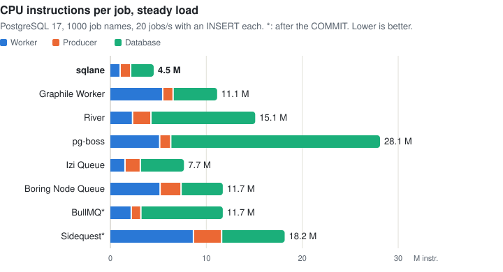
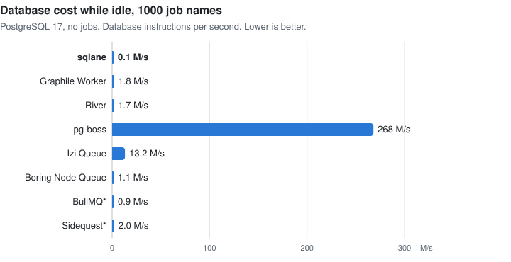
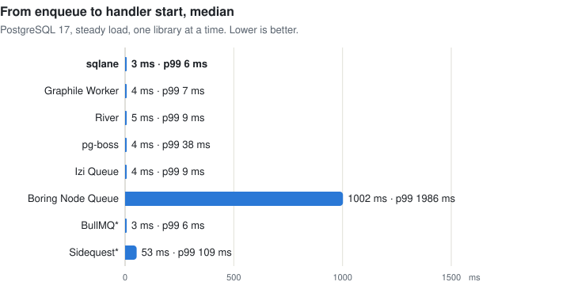
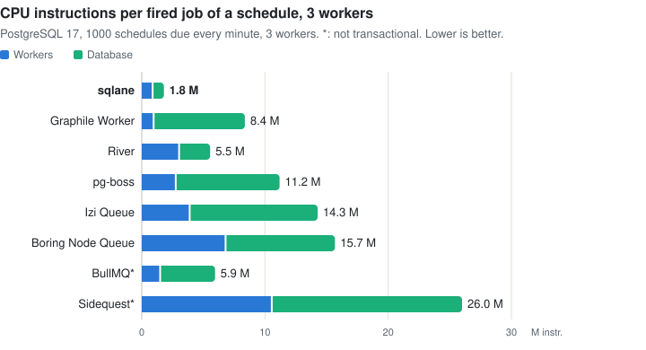

# sqlane

**Status: not production-ready yet.**

[](https://www.npmjs.com/package/@sqlane/core)
[](https://github.com/sqlane/sqlane-node/actions/workflows/ci.yml)
[](https://github.com/sqlane/sqlane-node/blob/main/LICENSE)

[Getting started](https://github.com/sqlane/sqlane-node/blob/main/README.md#getting-started) ·
[Adapters](https://github.com/sqlane/sqlane-node/blob/main/docs/adapters.md) ·
[API](https://github.com/sqlane/sqlane-node/blob/main/docs/api.md) ·
[Features vs other libs](https://github.com/sqlane/sqlane-node/blob/main/docs/features_vs_other_libs.md) ·
[Performance vs other libs](https://github.com/sqlane/sqlane-node/blob/main/docs/performance_vs_other_libs.md) ·
[Design](https://github.com/sqlane/sqlane-node/blob/main/docs/design.md)

Job queue for Node.js that runs in your SQL database. Jobs commit with your data: no Redis, no lost or orphaned jobs.
Works on PostgreSQL, MySQL and MariaDB.

Most apps save their data, then push a job to a separate queue. A crash between the two loses the job; a rollback after
the push leaves a job for data that never existed. sqlane stores each job as a row that you insert in your own
transaction, so:

- The job exists only if the transaction commits. A rollback removes it with your data.
- Workers can't see the job before the commit, so it never starts before its data is visible.
- A crash after the commit loses nothing: the job is in the database, and a worker runs it.

```js
import knex from 'knex';
import { createSqlane, defineJob } from '@sqlane/core';
import { knexAdapter } from '@sqlane/core/adapter-knex';

const db = knex({ client: 'pg', connection: process.env.DATABASE_URL }); // your app's pool
const queueDb = knex({ client: 'pg', connection: process.env.DATABASE_URL, pool: { max: 3 } }); // sqlane's own small pool

const sendReceipt = defineJob({ name: 'send_receipt' });
const sqlane = createSqlane({ adapter: knexAdapter(queueDb), jobs: [sendReceipt] });
await sqlane.migrate(); // creates the sqlane_* tables

// Worker: runs the job after the commit, in this process or another
sqlane.handle(sendReceipt, async ({ payload }) => sendReceiptEmail(payload.orderId));
await sqlane.start();

// Producer: the order and its job commit together, or not at all
await db.transaction(async (trx) => {
    await trx('orders').insert({ id: orderId, total: 42 });
    await sqlane.enqueue(trx, sendReceipt, { orderId });
});
```

sqlane claims jobs through its own small pool, so the queue and your app never wait for each other's connections.

## Why sqlane

- **Atomic with your data.** Enqueue in your existing transaction; the job commits or rolls back with it.
- **Multiple mutex keys per job.** Jobs that share a key, such as `order:42`, never run at the same time, across job
  names and processes. A job can hold up to 10 keys, for example an order and its customer. Handlers must stop when
  their `signal` aborts ([guarantees](https://github.com/sqlane/sqlane-node/blob/main/docs/design.md#guarantees)).
- **Idle job names are free.** One query per poll finds the names with pending jobs, so 1000 mostly idle names cost
  about what one does.
- **Fits your stack.** Adapters for mysql2, pg, postgres.js, Knex, Kysely, Drizzle, Prisma, Sequelize, TypeORM and
  MikroORM: enqueue with the transaction object you already have.
- **Not just PostgreSQL.** The same API on PostgreSQL, MySQL and MariaDB.

**Also:** [retries with backoff](https://github.com/sqlane/sqlane-node/blob/main/docs/api.md#backoff),
[delayed and unique jobs](https://github.com/sqlane/sqlane-node/blob/main/docs/api.md#enqueue),
[cron](https://github.com/sqlane/sqlane-node/blob/main/docs/api.md#schedule),
[failure jobs](https://github.com/sqlane/sqlane-node/blob/main/docs/api.md#failedjobpayload),
[concurrency limits](https://github.com/sqlane/sqlane-node/blob/main/docs/api.md#handle),
[typed payloads](https://github.com/sqlane/sqlane-node/blob/main/docs/api.md#typed-payloads),
[crash recovery](https://github.com/sqlane/sqlane-node/blob/main/docs/design.md#leases-and-stalls),
[graceful shutdown](https://github.com/sqlane/sqlane-node/blob/main/docs/api.md#close),
[events](https://github.com/sqlane/sqlane-node/blob/main/docs/api.md#events) and
[stats](https://github.com/sqlane/sqlane-node/blob/main/docs/api.md#getstats).

## How it compares

🔬 rows are verified by running each library next to sqlane on PostgreSQL 17; the others come from each library's
documentation ([full comparison](https://github.com/sqlane/sqlane-node/blob/main/docs/features_vs_other_libs.md)).

|                                        | sqlane | pg-boss | Graphile Worker | BullMQ | Sidequest    | River | Boring Node Queue | Izi Queue |
| -------------------------------------- | ------ | ------- | --------------- | ------ | ------------ | ----- | ----------------- | --------- |
| 🔬 Enqueue in the caller's transaction | ✅     | ✅      | ✅              | ❌     | ❌           | ✅    | ✅                | ✅        |
| 🔬 Multiple mutex keys per job         | ✅     | ❌      | ❌              | ❌     | ❌           | ❌    | ❌                | ❌        |
| 🔬 Timeout that aborts the handler     | ✅     | ✅      | ❌              | ❌     | ✅           | ✅    | ✅                | ✅        |
| 🔬 Priority                            | ❌     | ✅      | ✅              | ✅     | 🟠 per queue | ✅    | ✅                | ✅        |
| Cron                                   | ✅     | ✅      | ✅              | ✅     | ✅           | ✅    | ✅                | ✅        |
| Dashboard                              | ❌     | ✅      | ❌              | ✅     | ✅           | ✅    | ❌                | ❌        |

Supported databases, from each library's documentation:

|            | sqlane | pg-boss | Graphile Worker | BullMQ | Sidequest | River | Boring Node Queue | Izi Queue |
| ---------- | ------ | ------- | --------------- | ------ | --------- | ----- | ----------------- | --------- |
| PostgreSQL | ✅     | ✅      | ✅              | ✅     | ✅        | ✅    | ✅                | ✅        |
| MySQL      | ✅     | ❌      | ❌              | ❌     | ✅        | ❌    | ✅ Knex           | ✅        |
| MariaDB    | ✅     | ❌      | ❌              | ❌     | ❌        | ❌    | ✅ Knex           | ❌        |
| SQLite     | ❌     | ❌      | ❌              | ❌     | ✅        | ✅    | ✅                | ✅        |

## Performance

<picture>
  <source media="(prefers-color-scheme: dark)" srcset="https://raw.githubusercontent.com/sqlane/sqlane-node/main/docs/images/perf_cpu_per_job_dark.svg">
  
</picture>

<picture>
  <source media="(prefers-color-scheme: dark)" srcset="https://raw.githubusercontent.com/sqlane/sqlane-node/main/docs/images/perf_idle_dark.svg">
  
</picture>

<details>
<summary>More charts: latency, drain and cron</summary>

<picture>
  <source media="(prefers-color-scheme: dark)" srcset="https://raw.githubusercontent.com/sqlane/sqlane-node/main/docs/images/perf_latency_dark.svg">
  
</picture>

<picture>
  <source media="(prefers-color-scheme: dark)" srcset="https://raw.githubusercontent.com/sqlane/sqlane-node/main/docs/images/perf_drain_dark.svg">
   60 s, stopped, Boring Node Queue 12.3 s, BullMQ 1.2 s (after the commit), Sidequest 15.4 s (after the commit), BullMQ (Redis) 0.6 s (after the commit)" src="https://raw.githubusercontent.com/sqlane/sqlane-node/main/docs/images/perf_drain_light.svg">
</picture>

<picture>
  <source media="(prefers-color-scheme: dark)" srcset="https://raw.githubusercontent.com/sqlane/sqlane-node/main/docs/images/perf_cron_dark.svg">
  
</picture>

</details>

[Performance details →](https://github.com/sqlane/sqlane-node/blob/main/docs/performance_vs_other_libs.md)

## Install

```sh
npm install @sqlane/core
```

## Supported databases

| Database   | Versions | Wake-up in other processes                   | Notes                                                                                        |
| ---------- | -------- | -------------------------------------------- | -------------------------------------------------------------------------------------------- |
| PostgreSQL | 15+      | NOTIFY (pg, postgres.js, Drizzle), or a hint |                                                                                              |
| MySQL      | 8.4+     | A hint                                       |                                                                                              |
| MariaDB    | 10.11+   | A hint                                       | [Tell the adapter](https://github.com/sqlane/sqlane-node/blob/main/docs/adapters.md#mariadb) |

A hint is a message over Redis or another publish/subscribe service
([wake-up](https://github.com/sqlane/sqlane-node/blob/main/docs/adapters.md#wake-up-after-the-commit)). Without NOTIFY
or a hint, other processes find new jobs at their next poll, every 5 seconds by default. SQLite is not supported.

## Supported drivers and ORMs

| Library                                                                                    | Import                             | Versions                      | MySQL | MariaDB | PostgreSQL |
| ------------------------------------------------------------------------------------------ | ---------------------------------- | ----------------------------- | ----- | ------- | ---------- |
| [mysql2](https://github.com/sqlane/sqlane-node/blob/main/docs/adapters.md#mysql2)          | `@sqlane/core/adapter-mysql2`      | mysql2 3.11+                  | ✅    | ✅      |            |
| [pg](https://github.com/sqlane/sqlane-node/blob/main/docs/adapters.md#pg)                  | `@sqlane/core/adapter-pg`          | pg 8.13+                      |       |         | ✅         |
| [postgres.js](https://github.com/sqlane/sqlane-node/blob/main/docs/adapters.md#postgresjs) | `@sqlane/core/adapter-postgres-js` | postgres 3.4+ and 4           |       |         | ✅         |
| [Knex](https://github.com/sqlane/sqlane-node/blob/main/docs/adapters.md#knex)              | `@sqlane/core/adapter-knex`        | knex 3                        | ✅    | ✅      | ✅         |
| [Kysely](https://github.com/sqlane/sqlane-node/blob/main/docs/adapters.md#kysely)          | `@sqlane/core/adapter-kysely`      | kysely 0.28 and 0.29          | ✅    | ✅      | ✅         |
| [Drizzle](https://github.com/sqlane/sqlane-node/blob/main/docs/adapters.md#drizzle)        | `@sqlane/core/adapter-drizzle`     | drizzle-orm 0.45 and 1.0 (rc) | ✅    | ✅      | ✅         |
| [Prisma](https://github.com/sqlane/sqlane-node/blob/main/docs/adapters.md#prisma)          | `@sqlane/core/adapter-prisma`      | Prisma 7                      | ✅    | ✅      | ✅         |
| [Sequelize](https://github.com/sqlane/sqlane-node/blob/main/docs/adapters.md#sequelize)    | `@sqlane/core/adapter-sequelize`   | Sequelize 6                   | ✅    | ✅      | ✅         |
| [TypeORM](https://github.com/sqlane/sqlane-node/blob/main/docs/adapters.md#typeorm)        | `@sqlane/core/adapter-typeorm`     | TypeORM 0.3 and 1.x           | ✅    | ✅      | ✅         |
| [MikroORM](https://github.com/sqlane/sqlane-node/blob/main/docs/adapters.md#mikroorm)      | `@sqlane/core/adapter-mikro-orm`   | MikroORM 6 and 7              | ✅    | ✅      | ✅         |

## Getting started

The steps below rebuild the example above. With another library, only the adapter and the transaction code change
([adapters](https://github.com/sqlane/sqlane-node/blob/main/docs/adapters.md)).

**1. Define your jobs.** A job name, such as `send_receipt`, is also its queue. Keep the definitions in a module that
producers and workers both import; in TypeScript, `defineJob<{ orderId: number }>(…)` types the payload.

```js
export const sendReceipt = defineJob({ name: 'send_receipt', maxAttempts: 5 });
export const syncOrder = defineJob({ name: 'sync_order', mutexKeys: (order) => [`order:${order.orderId}`], timeout: '2m' });
```

Two `sync_order` jobs for the same order never run at the same time. A job with mutex keys needs a `timeout`.

**2. Create the instance and the tables.** Give sqlane its own pool of 2–3 connections. `migrate()` is safe to run
from several processes at once; to use your own migration tool, take the SQL from `getMigrations()`.

```js
const queueDb = knex({ client: 'pg', connection: process.env.DATABASE_URL, pool: { max: 3 } });
export const sqlane = createSqlane({ adapter: knexAdapter(queueDb), jobs: [sendReceipt, syncOrder] });
await sqlane.migrate();
```

**3. Enqueue in your transaction.** Pass your transaction to `enqueue`. A `jobId` deduplicates enqueues
([enqueue options](https://github.com/sqlane/sqlane-node/blob/main/docs/api.md#enqueue)).

```js
await db.transaction(async (trx) => {
    await trx('orders').insert({ id: orderId, total });
    await sqlane.enqueue(trx, sendReceipt, { orderId }, { jobId: String(orderId) });
});
```

**4. Handle jobs, start the worker, close on shutdown.** Pass the handler's `signal` to APIs that accept one, such as
`fetch`: it aborts on a timeout or a shutdown.

```js
sqlane.handle(sendReceipt, async ({ payload, signal }) => {
    await sendReceiptEmail(payload.orderId, { signal }); // your code
}, { maxConcurrency: 5, timeout: '1m' });
await sqlane.start();
process.once('SIGTERM', () => sqlane.close({ deadline: '30s' }));
```

**5. Test with `drain()`.** In tests, call `drain()` instead of `start()`. It runs the due jobs and returns counts.

```js
await placeOrder(42); // your code that enqueues send_receipt
const { completed, failed } = await sqlane.drain();
```

## Documentation

- The [API reference](https://github.com/sqlane/sqlane-node/blob/main/docs/api.md) describes every function and option.
- The [adapters page](https://github.com/sqlane/sqlane-node/blob/main/docs/adapters.md) explains each driver and ORM.
- The [comparison](https://github.com/sqlane/sqlane-node/blob/main/docs/features_vs_other_libs.md) puts sqlane next to other queues, and the
  [performance comparison](https://github.com/sqlane/sqlane-node/blob/main/docs/performance_vs_other_libs.md) measures their cost.
- The [design](https://github.com/sqlane/sqlane-node/blob/main/docs/design.md) explains how sqlane works inside.
- The [performance results](https://github.com/sqlane/sqlane-node/blob/main/docs/performance_results.md) give sqlane's own numbers on each database.
- The [examples folder](https://github.com/sqlane/sqlane-node/tree/main/examples) has more examples.
- The [changelog](https://github.com/sqlane/sqlane-node/blob/main/CHANGELOG.md) lists the changes of each version, and
  the [migration guide to 5.0](https://github.com/sqlane/sqlane-node/blob/main/docs/migrations/5.md) the changes of
  your code from 4.x.
- The [contributing guide](https://github.com/sqlane/sqlane-node/blob/main/CONTRIBUTING.md) explains the project setup.

## Versioning

sqlane follows [semantic versioning](https://semver.org). The
[changelog](https://github.com/sqlane/sqlane-node/blob/main/CHANGELOG.md) lists the changes of each version. New
[event](https://github.com/sqlane/sqlane-node/blob/main/docs/api.md#events) types may come in minor versions, so handle
unknown types in a `default` branch.

## Support and contributing

If you find a bug or have a question, open a [GitHub issue](https://github.com/sqlane/sqlane-node/issues). A use case
that sqlane does not cover yet is a good issue too. Please report a vulnerability privately, as
[SECURITY.md](https://github.com/sqlane/sqlane-node/blob/main/SECURITY.md) explains. To work on sqlane, read [CONTRIBUTING.md](https://github.com/sqlane/sqlane-node/blob/main/CONTRIBUTING.md).

## License

sqlane is released under the [MIT license](https://github.com/sqlane/sqlane-node/blob/main/LICENSE).
