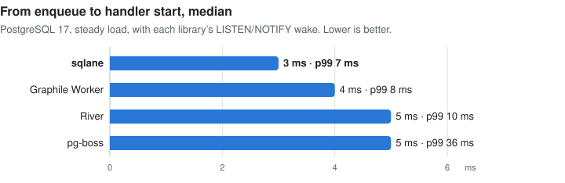
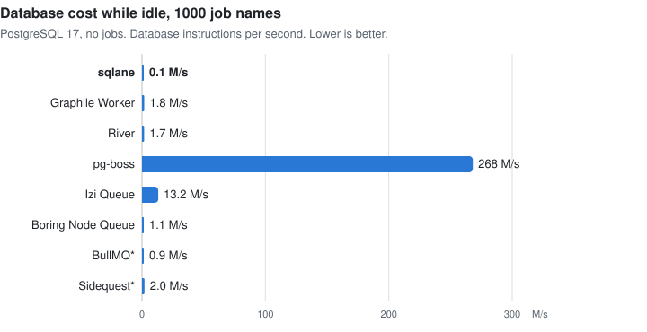

# Compare job queues: performance

The CPU cost, latency and idle cost of the Node.js job queues that enqueue in your SQL transaction: sqlane, pg-boss,
Graphile Worker and River. They give the same guarantee, so they run the same workload. BullMQ and Sidequest enqueue on
their own connection ([features](comparison.md)) and are not measured. Each library runs with the settings that its
documentation offers for throughput ([settings](#settings)).

## Summary

On PostgreSQL 17, one worker process, 1000 job names, empty handlers:

- **CPU per job, steady load:** sqlane uses **4.6 M** instructions per job in all processes. Graphile Worker uses 2.3×
  as many, River 3.1× and pg-boss 5.8×.
- **Commit to handler start, p50:** sqlane **3 ms**, Graphile Worker 4 ms, River and pg-boss 5 ms.
- **Idle names are free:** sqlane, Graphile Worker and River poll once for all job names, so 1000 names cost what 1
  costs. pg-boss polls each queue: 1000 idle queues take about a quarter of a database core.
- **Drain of 10,000 jobs:** pg-boss is the fastest at **0.4 s**, with up to 8 jobs at once in each of its 1000 queues.
  sqlane takes 1.7 s, Graphile Worker 1.8 s and River 2.3 s, each with 8 slots. sqlane uses the fewest instructions
  per job.

With their defaults, River waits 100 ms between two fetches, and pg-boss fetches one job at a time. We use the settings
that their documentation offers for throughput ([settings](#settings)).

<picture>
  <source media="(prefers-color-scheme: dark)" srcset="https://raw.githubusercontent.com/sqlane/sqlane-node/main/docs/images/perf-cpu-per-job-dark.svg">
  
</picture>

One run on a laptop: differences of about 10% are noise. Repeat it on your hardware before you plan capacity
([reproduce](#reproduce)).

## Steady load

A producer process enqueues 20 jobs per second, each in a transaction with an `INSERT` into a business table. 9 of 10
jobs go to 10 hot names, the rest to the other 990. A 15 s window after a 5 s warm-up. Per job, on PostgreSQL:

<picture>
  <source media="(prefers-color-scheme: dark)" srcset="https://raw.githubusercontent.com/sqlane/sqlane-node/main/docs/images/perf-latency-dark.svg">
  
</picture>

| Library         | Instructions (M) | vs sqlane | Worker / producer / database | CPU ms | Latency p50 / p99 ms |
| --------------- | ---------------- | --------- | ---------------------------- | ------ | -------------------- |
| sqlane          | **4.6**          | 1×        | 1.3 / 1.1 / 2.3              | 4.9    | **3** / 7            |
| Graphile Worker | 10.9             | 2.3×      | 5.5 / 0.9 / 4.4              | 7.2    | 4 / 8                |
| River           | 14.6             | 3.1×      | 2.3 / 1.9 / 10.4             | 8.4    | 5 / 10               |
| pg-boss         | 27.0             | 5.8×      | 5.4 / 1.2 / 20.5             | 11.2   | 5 / 36               |

sqlane on the other databases, same workload:

| Database | Instructions (M) | Worker / producer / database | CPU ms | Latency p50 / p99 ms |
| -------- | ---------------- | ---------------------------- | ------ | -------------------- |
| MySQL    | 14.5             | 3.2 / 1.6 / 9.7              | 13.4   | 9 / 37               |
| MariaDB  | 10.6             | 3.3 / 1.6 / 5.6              | 12.7   | 36 / 45              |

Latency is from the enqueue, before the `COMMIT`, to the start of the handler. River's fetch cooldown, the minimum time
between two claims, also spaces a producer's insert notifications: 1 ms here. With its default of 100 ms, River used
11.8 M per job, but its jobs started 57 ms after the enqueue (p50), and a drain of 10,000 jobs took 126 s (the run of 11
November 2026, under `defaults` in `results.json`). On MariaDB a commit syncs the binary log, which took about 5 ms on
macOS (see [limits](#method-and-limits)).

## Idle

No jobs, nothing due. Per second:

<picture>
  <source media="(prefers-color-scheme: dark)" srcset="https://raw.githubusercontent.com/sqlane/sqlane-node/main/docs/images/perf-idle-dark.svg">
  
</picture>

| Library         | Job names | Database instructions (M) | Worker instructions (M) | SQL statements | Connections |
| --------------- | --------- | ------------------------- | ----------------------- | -------------- | ----------- |
| sqlane          | 1         | 0.1                       | 0.4                     | 0.2            | 2           |
| sqlane          | 1000      | 0.1                       | 0.5                     | 0.2            | 2           |
| Graphile Worker | 1         | 0.9                       | 1.7                     | 1.6            | 5           |
| Graphile Worker | 1000      | 2.0                       | 4.8                     | 1.6            | 5           |
| River           | 1         | 1.8                       | 3.7                     | 2.1            | 5           |
| River           | 1000      | 1.6                       | 3.8                     | 2.1            | 5           |
| pg-boss         | 1         | 3.8                       | 3.0                     | 2.5            | 6           |
| pg-boss         | 1000      | **266.8**                 | **73.4**                | **202.9**      | 6           |

pg-boss polls each queue, so 1000 queues are 200 fetches per second at a 5 s interval. pg-boss can run several job
names through one queue, with the name in the data; then it polls once, but the queue's options (retries, expiry) are
shared.

## Drain

10,000 due jobs over the 1000 job names, enqueued before the worker starts. The time until the worker has run them all:

| Library         | Time      | Jobs at once | Instructions per job (M), worker / database = total |
| --------------- | --------- | ------------ | --------------------------------------------------- |
| pg-boss         | **0.4 s** | up to 8,000  | 0.4 / 1.1 = 1.5                                     |
| sqlane          | 1.7 s     | 8            | 0.5 / 0.7 = **1.2**                                 |
| Graphile Worker | 1.8 s     | 8            | 2.6 / 3.3 = 6.0                                     |
| River           | 2.3 s     | 8            | 0.8 / 0.8 = 1.6                                     |

- pg-boss: a fetch takes up to 8 jobs and a full one fetches again at once, so each queue runs its 10 jobs in two
  fetches. Its slots are per queue, so with real handlers up to 8,000 can run at once. With its defaults, one job per
  fetch and then a wait for the next poll, it took 45 s.
- River: 8 workers per fetch cooldown of 1 ms. With its default of 100 ms, about 80 jobs per second, it took 126 s.

## Method and limits

Measured on 11 November 2026 with `pnpm bench:compare`: Apple M1 Pro (8 cores), 16 GiB, macOS 27.2, Node.js 26.13.0,
PostgreSQL 17.11, MySQL 8.4.13 and MariaDB 11.8.9 from Homebrew, on the host. Versions: sqlane 2.0.1, pg-boss 12.38.2,
Graphile Worker 0.18.0, River for JavaScript 0.3.2. River's numbers come from a second run in the same hour.

Each library models 1000 job names in its own way, as its documentation describes:

| Library         | 1000 job names                  | Worker                                    |
| --------------- | ------------------------------- | ----------------------------------------- |
| sqlane          | 1000 handlers                   | 8 slots                                   |
| pg-boss         | 1000 queues, a `work()` on each | 1 slot per queue: its slots are per queue |
| Graphile Worker | 1000 tasks                      | `concurrency: 8`                          |
| River           | 1000 kinds in one queue         | `maxWorkers: 8`                           |

### Settings

Each library runs with the settings that its documentation offers for throughput, where they differ from its defaults:

| Library         | Setting                                    | Its default | Why                                                                                                                                                                                       |
| --------------- | ------------------------------------------ | ----------- | ----------------------------------------------------------------------------------------------------------------------------------------------------------------------------------------- |
| sqlane          | —                                          |             |                                                                                                                                                                                           |
| Graphile Worker | —                                          |             | Its documentation offers no such setting.                                                                                                                                                 |
| River           | `fetchCooldown: 1 ms`, its minimum         | 100 ms      | The minimum time between two claims, which also spaces the insert notifications. It costs CPU: with its default, 11.8 M per job instead of 14.6 M, but a 57 ms latency and a 126 s drain. |
| pg-boss         | `batchSize: 8`, `burstWhenBatchFull: true` | `1`, off    | A fetch takes up to the 8 slots of the worker, and a full one fetches again at once, instead of after the next poll. With its defaults, the drain took 45 s.                              |

- One worker process, empty handlers: the numbers are the cost of the queue. With real work, the handlers dominate, and
  the differences shrink.
- A poll every 5 s, plus each library's wakes: LISTEN/NOTIFY on PostgreSQL (pg-boss: `useListenNotify` and `notify` on
  each queue, which are off by default). On MySQL and MariaDB, sqlane's hint goes over UDP on localhost, standing in
  for Redis.
- The pools keep their connections: a closed connection takes its CPU counters with it.
- **Instructions** retired are the measure to compare: they do not depend on the core or the clock. CPU time does, on
  Apple Silicon (see [CPU cost per job](cpu-cost.md#the-three-numbers)). The database counts the processes of its
  connections only, not autovacuum or the checkpointer.
- One machine, one run, 15 s windows: differences of about 10% are noise. Instructions repeat within about 3%;
  latencies vary more between runs.
- The setups do not have the same capacity: pg-boss has its slots per queue, the others 8 slots in all.
- macOS: a commit took about 0.2 ms on MySQL and 5 ms on MariaDB with its binary log synced (`sync_binlog=1`, as MySQL
  8.4). On Linux both wait for the disk.

## Reproduce

```sh
pnpm bench:compare --only perf     # about 12 minutes
pnpm bench:compare --only perf --libs sqlane,river
```

The adapters in `bench/compare/libs/` show each library's configuration, `bench/compare/perf.mjs` the workloads, and
`bench/compare/results.json` the raw numbers of this page. `node bench/compare/charts.mjs` draws the charts from them.
See [bench/compare](../bench/compare/README.md).
