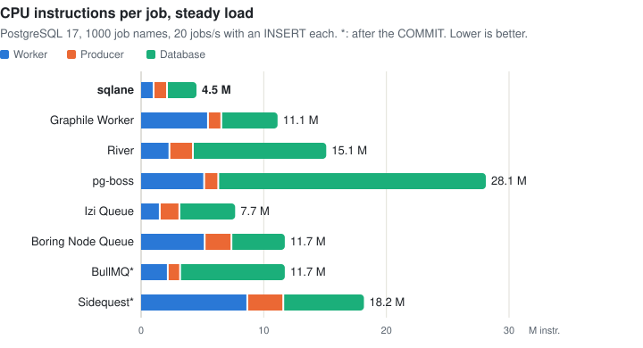
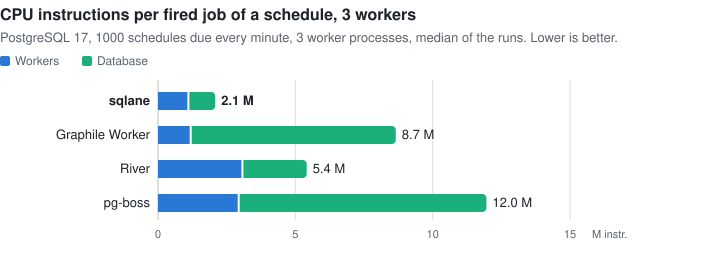

# Compare job queues: performance

The CPU cost, latency and idle cost of Node.js job queues on SQL databases and Redis, and of their cron schedules:
sqlane, pg-boss, Graphile Worker, River, Izi Queue and Boring Node Queue, which enqueue in your SQL transaction, and
BullMQ and Sidequest, which cannot: they enqueue after the `COMMIT`, **not atomic**, and their rows say so
([features](comparison.md)). Each library runs with the settings that its documentation offers for throughput
([settings](#settings)). The instructions come from all the libraries at once, the times from one library at a time
([method](#method-and-limits)).

## Summary

One worker process, 1000 job names, empty handlers:

- **CPU per job, steady load, PostgreSQL 17:** sqlane uses **4.5 M** instructions per job in all processes. Izi Queue
  uses 1.7× as many, Graphile Worker 2.5×, Boring Node Queue 2.6×, BullMQ 2.6× (not atomic), River 3.3×, Sidequest 4.0×
  (not atomic) and pg-boss 6.2×. BullMQ on Redis uses 5.7 M, 1.3×, not atomic, at a weaker durability.
- **MySQL and MariaDB:** sqlane loses on MySQL: it uses 14.4 M per job, and Izi Queue 9.1 M. Boring Node Queue uses 15.2
  M, Sidequest 25.8 M. On MariaDB, sqlane 10.5 M and Boring Node Queue 11.7 M.
- **Commit to handler start, p50, PostgreSQL:** BullMQ 2–3 ms, sqlane 3 ms, Izi Queue, Graphile Worker and pg-boss 4 ms,
  River 5 ms. The libraries that only poll take longer: Sidequest 53 ms, Boring Node Queue 1 s.
- **Idle names are free** for most. pg-boss polls each queue: 1000 idle queues take 268 M database instructions and 200
  statements per second, about 4% of a core. Graphile Worker's cost about doubles with 1000 names; Izi Queue's poll
  every 100 ms costs it 13–14 M database instructions per second.
- **Drain of 10,000 jobs, PostgreSQL and Redis:** pg-boss is the fastest at **0.4 s**, then BullMQ (0.5 s on Redis, 1.0
  s on PostgreSQL) and sqlane (1.4 s). sqlane uses the fewest instructions per job on PostgreSQL (1.2 M); BullMQ on
  Redis uses fewer (1.1 M).
- **Schedules** (sqlane 4.0.0): 1000 schedules due every minute cost sqlane **1.7 M** instructions per fired job with
  one worker, and 2.1 M with three, since each of its workers tries each slot. River uses 2.7× and 2.6× as many,
  Graphile Worker 4.5× and 4.2×, pg-boss 5.1× and 5.7×. No library added a slot twice ([schedules](#schedules)).

With their defaults, River waits 100 ms between two fetches, Izi Queue a second, and pg-boss fetches one job at a time
and forwards at most 600 cron jobs a minute per instance. We use the settings that their documentation offers for
throughput ([settings](#settings)).

<picture>
  <source media="(prefers-color-scheme: dark)" srcset="https://raw.githubusercontent.com/sqlane/sqlane-node/main/docs/images/perf-cpu-per-job-dark.svg">
  
</picture>

One run on a laptop: differences of about 10% are noise. Repeat it on your hardware before you plan capacity
([reproduce](#reproduce)).

## Steady load

A producer process enqueues 20 jobs per second, each in a transaction with an `INSERT` into a business table. BullMQ
and Sidequest enqueue after the `COMMIT`, on their own connection. 9 of 10 jobs go to 10 hot names, the rest to the
other 990. Per job, on PostgreSQL, in 15 s windows: instructions with all the libraries at once; CPU time and latency
with one library at a time:

<picture>
  <source media="(prefers-color-scheme: dark)" srcset="https://raw.githubusercontent.com/sqlane/sqlane-node/main/docs/images/perf-latency-dark.svg">
  
</picture>

| Library                                     | Instructions (M) | vs sqlane | Worker / producer / database | CPU ms | Latency p50 / p99 ms |
| ------------------------------------------- | ---------------- | --------- | ---------------------------- | ------ | -------------------- |
| sqlane                                      | **4.5**          | 1×        | 1.1 / 1.1 / 2.3              | 4.9    | 3 / 6                |
| Izi Queue                                   | 7.7              | 1.7×      | 1.6 / 1.6 / 4.5              | 6.0    | 4 / 9                |
| Graphile Worker                             | 11.1             | 2.5×      | 5.5 / 1.1 / 4.5              | 6.5    | 4 / 7                |
| Boring Node Queue                           | 11.7             | 2.6×      | 5.3 / 2.2 / 4.3              | 5.7    | 1,002 / 1,986        |
| BullMQ, enqueue after commit, not atomic    | 11.7             | 2.6×      | 2.2 / 1.0 / 8.5              | 8.6    | 3 / 6                |
| River                                       | 15.1             | 3.3×      | 2.4 / 1.9 / 10.8             | 8.5    | 5 / 9                |
| Sidequest, enqueue after commit, not atomic | 18.2             | 4.0×      | 8.7 / 2.9 / 6.5              | 10.3   | 53 / 109             |
| pg-boss                                     | 28.1             | 6.2×      | 5.2 / 1.2 / 21.7             | 8.6    | 4 / 38               |

On the other databases, same workload, all the libraries at once: instructions only, since the latency and the CPU
time of a library depend on the others' load. BullMQ on Redis also ran alone:

| Library                                     | Database                                           | Instructions (M) | Worker / producer / database | CPU ms | Latency p50 / p99 ms |
| ------------------------------------------- | -------------------------------------------------- | ---------------- | ---------------------------- | ------ | -------------------- |
| BullMQ, enqueue after commit, not atomic    | Redis 8.10, with PostgreSQL for the business table | 5.7              | 2.4 / 1.1 / 2.3              | 5.7    | 2 / 6                |
| Izi Queue                                   | MySQL 8.4                                          | 9.1              | 2.0 / 1.1 / 6.0              | —      | —                    |
| sqlane                                      | MySQL 8.4                                          | 14.4             | 3.1 / 1.6 / 9.7              | —      | —                    |
| Boring Node Queue                           | MySQL 8.4                                          | 15.2             | 5.8 / 2.1 / 7.3              | —      | —                    |
| Sidequest, enqueue after commit, not atomic | MySQL 8.4                                          | 25.8             | 10.6 / 4.2 / 11.0            | —      | —                    |
| sqlane                                      | MariaDB 11.8                                       | 10.5             | 3.2 / 1.6 / 5.7              | —      | —                    |
| Boring Node Queue                           | MariaDB 11.8                                       | 11.7             | 5.4 / 2.0 / 4.2              | —      | —                    |

Latency is from the enqueue to the start of the handler: before the `COMMIT` for the libraries that enqueue in the
transaction, after it for BullMQ and Sidequest. The wakes differ: LISTEN/NOTIFY for sqlane, pg-boss, Graphile Worker,
River and Izi Queue on PostgreSQL; Redis for BullMQ; a poll for the others. Boring Node Queue 0.9.1 polls every 2 s
when idle (`idleDelay`, documented, its default): its 1 s p50 is half of it; 0.10.0 adds LISTEN/NOTIFY. Sidequest polls
every 100 ms, its default. River's fetch cooldown also spaces a producer's insert notifications: 1 ms here. With its
default of 100 ms, River used 11.8 M per job, but its jobs started 57 ms after the enqueue (p50), and a drain of
10,000 jobs took 126 s (the run of 11 November 2026, under `defaults` in `results.json`). BullMQ on Redis syncs its
append-only file every second, so a crash can lose up to a second of jobs that PostgreSQL would have kept.

## Idle

No jobs, nothing due. Per second, with 1 and 1000 job names, all the libraries at once:

<picture>
  <source media="(prefers-color-scheme: dark)" srcset="https://raw.githubusercontent.com/sqlane/sqlane-node/main/docs/images/perf-idle-dark.svg">
  
</picture>

| Library           | Database   | Database instructions (M), 1 / 1000 names | Worker instructions (M), 1 / 1000 names | SQL statements, 1000 names | Connections |
| ----------------- | ---------- | ----------------------------------------- | --------------------------------------- | -------------------------- | ----------- |
| sqlane            | PostgreSQL | 0.5 / 0.1                                 | 0.6 / 0.6                               | 0.2                        | 2           |
| BullMQ            | PostgreSQL | 0.8 / 0.9                                 | 0.7 / 0.8                               | 0.8                        | 4           |
| Boring Node Queue | PostgreSQL | 1.1 / 1.1                                 | 3.4 / 3.4                               | 4.7                        | 1           |
| River             | PostgreSQL | 2.2 / 1.7                                 | 3.7 / 3.7                               | 2.1                        | 5           |
| Graphile Worker   | PostgreSQL | 0.8 / 1.8                                 | 1.5 / 5.2                               | 1.6                        | 5           |
| Sidequest         | PostgreSQL | 2.0 / 2.0                                 | 6.1 / 6.1                               | 9.7                        | 3           |
| Izi Queue         | PostgreSQL | 14.0 / 13.2                               | 7.6 / 7.6                               | 11.0                       | 2           |
| pg-boss           | PostgreSQL | 5.0 / **268.1**                           | 3.2 / **72.6**                          | **200.3**                  | 6           |
| BullMQ            | Redis      | 0.9 / 1.2                                 | 0.4 / 0.4                               | —                          | —           |
| sqlane            | MySQL      | 3.5 / 3.8                                 | 1.3 / 6.5                               | —                          | —           |
| Sidequest         | MySQL      | 4.3 / 5.4                                 | 7.0 / 7.2                               | —                          | —           |
| Boring Node Queue | MySQL      | 4.8 / 5.9                                 | 4.6 / 4.7                               | —                          | —           |
| Izi Queue         | MySQL      | 18.8 / 19.9                               | 14.6 / 16.3                             | —                          | —           |
| sqlane            | MariaDB    | 0.1 / 0.2                                 | 0.8 / 1.6                               | —                          | —           |
| Boring Node Queue | MariaDB    | 0.9 / 0.9                                 | 4.6 / 4.8                               | —                          | —           |

pg-boss polls each queue, so 1000 queues are 200 fetches per second at a 5 s interval. pg-boss can run several job
names through one queue, with the name in the data; then it polls once, but the queue's options (retries, expiry) are
shared. Izi Queue polls every 100 ms, the setting that lets it keep up with the load. On MySQL and MariaDB the database
is the whole server process, with its background threads, so the idle numbers there are noisy.

## Drain

10,000 due jobs over the 1000 job names, enqueued before the worker starts. The time until the worker has run them all,
at most 60 s, one library at a time:

| Library           | Database   | Time    | Jobs at once | Instructions per job (M), worker / database = total |
| ----------------- | ---------- | ------- | ------------ | --------------------------------------------------- |
| pg-boss           | PostgreSQL | 0.4 s   | up to 8,000  | 0.4 / 1.1 = 1.5                                     |
| BullMQ            | Redis      | 0.5 s   | 8            | 0.6 / 0.5 = 1.1                                     |
| BullMQ            | PostgreSQL | 1.0 s   | 8            | 0.6 / 2.4 = 3.0                                     |
| sqlane            | PostgreSQL | 1.4 s   | 8            | 0.5 / 0.7 = 1.2                                     |
| Graphile Worker   | PostgreSQL | 1.9 s   | 8            | 2.6 / 3.3 = 6.0                                     |
| River             | PostgreSQL | 2.2 s   | 8            | 0.8 / 0.8 = 1.6                                     |
| Boring Node Queue | PostgreSQL | 8.2 s   | 8            | 3.8 / 3.1 = 6.9                                     |
| Sidequest         | PostgreSQL | 9.9 s   | 8            | 5.7 / 8.8 = 14.5                                    |
| Izi Queue         | PostgreSQL | > 60 s² | 8            | 1.1 / 6.7 = 7.8                                     |

² Stopped after 60 s, when Izi Queue had run 4,296 jobs: its instructions are per job that ran.

- On MySQL and MariaDB the drains ran only with all the libraries at once, where a drain changes with the others' load:
  in that phase, with all the lanes draining at once, River's instructions per job were 3.7× those of its drain alone.
  So no drain is given for them; `results.json` has those runs.
- pg-boss: a fetch takes up to 8 jobs and a full one fetches again at once, so each queue runs its 10 jobs in two
  fetches. Its slots are per queue, so with real handlers up to 8,000 can run at once. With its defaults, one job per
  fetch and then a wait for the next poll, it took 45 s.
- River: 8 workers per fetch cooldown of 1 ms. With its default of 100 ms, about 80 jobs per second, it took 126 s.
- Izi Queue: 8 jobs per poll of 100 ms at most, about 70 jobs per second.

## Schedules

1000 cron schedules of one job name, told apart by a key, with empty handlers. Each library schedules in its own way
([method](#method-and-limits)). The median of 3 runs.

<picture>
  <source media="(prefers-color-scheme: dark)" srcset="https://raw.githubusercontent.com/sqlane/sqlane-node/main/docs/images/perf-cron-dark.svg">
  
</picture>

**Firing.** All 1000 schedules due every minute (`* * * * *`), with 1 and with 3 worker processes. The CPU of all
the processes and the database over one minute, per fired job (one slot of one schedule), with the range of the 3
runs. Jobs and lag of two slots. The lags come from runs that fire in the same second on one machine: compare
their order of magnitude.

| Library         | Workers | Instructions per job (M), median workers / median database = sum | Range of the totals | Statements per job | Jobs started per minute | Slot to handler start, p50 / p99 |
| --------------- | ------- | ---------------------------------------------------------------- | ------------------- | ------------------ | ----------------------- | -------------------------------- |
| sqlane          | 1       | 0.5 / 1.1 = **1.7**                                              | 1.3–1.7             | 0.33               | 1000                    | 0.3 s / 0.7 s                    |
| sqlane          | 3       | 1.1 / 0.9 = **2.1**                                              | 2.0–2.1             | 0.45               | 1000                    | 0.2 s / 0.3 s                    |
| Graphile Worker | 1       | 0.8 / 6.6 = 7.4                                                  | 7.4–7.4             | 2.10               | 1000                    | 0.8 s / 1.0 s                    |
| Graphile Worker | 3       | 1.2 / 7.4 = 8.7                                                  | 6.7–8.7             | 2.29               | 1000                    | 0.7 s / 0.9 s                    |
| River           | 1       | 2.4 / 2.1 = 4.5                                                  | 4.4–4.5             | 0.28               | 1000                    | 0.7 s / 0.9 s                    |
| River           | 3       | 3.1 / 2.3 = 5.4                                                  | 5.3–5.5             | 0.44               | 1000                    | 0.5 s / 0.6 s                    |
| pg-boss         | 1       | 2.2 / 6.2 = 8.4                                                  | 8.0–8.7             | 3.79               | 1000                    | 28 s / 37 s                      |
| pg-boss³        | 3       | 3.0 / 9.0 = 12.0                                                 | 10.4–17.1           | 8.57               | 1000                    | 20 s / 24 s                      |

³ The median of 6 runs, pooled with the rerun; the other columns of this row come from the 3 runs of the table.

- **One job per slot.** After each run, the library's tables give the jobs that it stored: one per schedule and slot for
  Graphile Worker (with the jobs that its handlers ran, since it deletes a completed job) and River. For sqlane it is
  enforced, not measured: the job id `<name>:schedule:<key>:<slot>` is the primary key. pg-boss's jobs do not carry
  their slot: its cron pass filed each slot once, and no schedule had more jobs than forwarded occurrences. No library
  added a slot twice, in any run. The runs cover a steady state only, not a leader change, a crash, a missed slot or
  clock skew.
- **sqlane has no leader, so it pays per worker.** Every worker tries every slot, and a row lock picks one. From 1 to 3
  workers its cost per job grows by about 25%, Graphile Worker's by 17% and River's by 21%. sqlane still uses the
  fewest instructions: per job, River uses 2.7× as many with one worker and 2.6× with three, Graphile Worker 4.5× and
  4.2×, pg-boss 5.1× and 5.7×. The runs of sqlane with one worker spread by about a quarter (1.3–1.7 M).
- **River:** its leader inserts all 1000 jobs at the slot. Each worker claims at most 8 jobs (the benchmark's
  `maxWorkers`) per fetch cooldown, 1 ms here, so they all start within about a second. With the default cooldown of
  100 ms, 1000 jobs took 13 s to start with one worker (p99; the run of 12 November 2026, under `defaults`).
- **pg-boss:** a cron pass every 30 s files the due occurrences into an internal queue, and each instance forwards them
  to the job's queue, 50 per poll: every 1 s here, 3,000 a minute. The lag is the wait for the 30 s pass, which depends
  on where it falls in the minute, plus about 20 s to forward 1000. With 3 instances its runs varied most: 6 runs, the 3
  of the table and the 3 of a rerun the same day, gave 10.4 to 17.1 M per job, a median of 12.0 M (³; `pooled` and
  `cronRerun` in `results.json`). With the default poll of 5 s, one instance forwards at most 600 a minute: with 1000
  schedules due every minute it fell behind, and its backlog grew by 400 a minute (the run of 12 November 2026, under
  `defaults` in `results.json`).

**Idle.** No slot due in the window, 1 worker, no jobs. A daily cron 12 hours away; and, for pg-boss, whose cost
depends on the expression, a yearly one too. Per second:

| Library         | Schedules | Cron   | Database instructions (M) | Worker instructions (M) | SQL statements | Connections |
| --------------- | --------- | ------ | ------------------------- | ----------------------- | -------------- | ----------- |
| sqlane          | 1         | daily  | 0.3                       | 0.7                     | 0.4            | 2           |
| sqlane          | 1000      | daily  | 0.3                       | 1.6                     | 0.4            | 2           |
| Graphile Worker | 1         | daily  | 1.0                       | 1.7                     | 1.6            | 5           |
| Graphile Worker | 1000      | daily  | 1.2                       | 2.3                     | 1.6            | 5           |
| River           | 1         | daily  | 1.9                       | 4.9                     | 2.4            | 5           |
| River           | 1000      | daily  | 1.8                       | 7.8                     | 2.4            | 5           |
| pg-boss         | 1         | daily  | 7.2                       | 5.0                     | 4.3            | 6           |
| pg-boss         | 1000      | daily  | 7.8                       | 25.4                    | 4.3            | 6           |
| pg-boss         | 1000      | yearly | 7.9                       | 182.3                   | 4.3            | 6           |

In all four, 1000 schedules run as many statements as 1. sqlane and Graphile Worker sleep until the next slot or
minute; River's leader wakes every 5 s and walks its periodic jobs. pg-boss's cron pass reads all the schedules in one
statement, and evaluates each cron in the worker with its cron parser: every 30 s, 1000 daily schedules took 25.4 M
instructions per second, and 1000 yearly ones 182.3 M, since the parser searches a sparse cron far longer.
`results.json` also has sqlane, Graphile Worker and River with a yearly cron.

How they schedule, and what they guarantee:

| Library         | Who adds the jobs                                  | When it checks                                                                                                             | One job per slot                                                                                                    | Missed slots, by default                                                                     |
| --------------- | -------------------------------------------------- | -------------------------------------------------------------------------------------------------------------------------- | ------------------------------------------------------------------------------------------------------------------- | -------------------------------------------------------------------------------------------- |
| sqlane          | Every worker that has the schedule, with no leader | A timer for the next slot of all its schedules, at most 1 minute                                                           | A row per schedule, locked with `SKIP LOCKED` in the transaction of the insert; the database clock decides the slot | The latest one runs once (`missed: 'once'`)                                                  |
| pg-boss         | The instance whose compare-and-set claims the pass | A pass every 30 s (`cronMonitorIntervalSeconds`); each instance forwards every 5 s (`cronWorkerIntervalSeconds`; 1 s here) | The claim, and a singleton key per schedule and minute; a skew to the database clock, measured every 10 minutes     | Skipped (`missed: 'skip'`), but a pass sends an occurrence up to 60 s old, also at its start |
| Graphile Worker | Every worker, with no leader                       | A timer at each minute of the process clock                                                                                | A conditional upsert of the item's last run in `_private_known_crontabs`, in the statement that adds the job        | Skipped (`backfillPeriod: 0`)                                                                |
| River           | The elected leader (an election every 5 s)         | A timer for the next occurrence, on the leader                                                                             | The leadership; no record per slot in the database, unless an extension adds a periodic job store                   | Skipped: a new leader starts from the next occurrence                                        |

## Method and limits

The jobs were measured on 12 November 2026 with `pnpm bench:compare --only perf`: Apple M1 Pro (8 cores), 16 GiB,
macOS 27.2, Node.js 26.13.0, PostgreSQL 17.11, MySQL 8.4.13, MariaDB 11.8.9 and Redis 8.10.3 from Homebrew, on the host.
Versions: sqlane 4.0.1, pg-boss 12.38.2, Graphile Worker 0.18.0, River for JavaScript 0.3.2, BullMQ 6.7.4 (ioredis
6.0.0 on Redis), Sidequest 1.17.0, Boring Node Queue 0.9.1 (Knex 3.3.0), Izi Queue 0.10.0, with pg 8.23.1 and mysql2
3.24.6.

Each library models 1000 job names in its own way, as its documentation describes:

| Library           | 1000 job names                  | Worker                                    |
| ----------------- | ------------------------------- | ----------------------------------------- |
| sqlane            | 1000 handlers                   | 8 slots                                   |
| pg-boss           | 1000 queues, a `work()` on each | 1 slot per queue: its slots are per queue |
| Graphile Worker   | 1000 tasks                      | `concurrency: 8`                          |
| River             | 1000 kinds in one queue         | `maxWorkers: 8`                           |
| BullMQ            | 1000 job names in one queue     | `concurrency: 8`                          |
| Sidequest         | 1000 job classes                | `maxConcurrentJobs: 8`                    |
| Boring Node Queue | 1000 job classes in one queue   | `concurrency: 8`                          |
| Izi Queue         | 1000 workers in one queue       | a queue of 8                              |

### Settings

Each library runs with the settings that its documentation offers for throughput, where they differ from its defaults:

| Library           | Setting                                     | Its default | Why                                                                                                                                                                                                                                          |
| ----------------- | ------------------------------------------- | ----------- | -------------------------------------------------------------------------------------------------------------------------------------------------------------------------------------------------------------------------------------------- |
| sqlane            | —                                           |             |                                                                                                                                                                                                                                              |
| Graphile Worker   | —                                           |             | Its documentation offers no such setting.                                                                                                                                                                                                    |
| River             | `fetchCooldown: 1 ms`, its minimum          | 100 ms      | The minimum time between two claims, which also spaces the insert notifications. It costs CPU: on 11 November, 11.8 M per job with its default and 14.6 M with 1 ms, but a 57 ms latency and a 126 s drain with its default.                 |
| pg-boss           | `batchSize: 8`, `burstWhenBatchFull: true`  | `1`, off    | A fetch takes up to the 8 slots of the worker, and a full one fetches again at once, instead of after the next poll. With its defaults, the drain took 45 s.                                                                                 |
| pg-boss           | `cronWorkerIntervalSeconds: 1`, its minimum | 5 s         | It forwards the cron pass's occurrences as jobs, 50 per poll: 3,000 a minute per instance instead of 600.                                                                                                                                    |
| Izi Queue         | `pollInterval: 100 ms`                      | 1 s         | A queue fetches up to its free slots once per poll: with its default, 8 jobs a second here, below the 20 of the load. It costs idle time: 13–14 M database instructions per second. A public option of its configuration, not in its README. |
| BullMQ            | —                                           |             | A worker blocks on Redis for the next job; completed jobs stay (`removeOnComplete`).                                                                                                                                                         |
| Sidequest         | —                                           |             | A poll every 100 ms (`jobPollingInterval`), its only wake.                                                                                                                                                                                   |
| Boring Node Queue | —                                           |             | Its worker fetches again as soon as a job completes; `idleDelay` (2 s) only sets the poll when idle, its only wake in 0.9.1.                                                                                                                 |

- One worker process, empty handlers: the numbers are the cost of the queue. With real work, the handlers dominate, and
  the differences shrink.
- **Wakes:** each library's own: LISTEN/NOTIFY on PostgreSQL with a poll every 5 s as a fallback (pg-boss:
  `useListenNotify` and `notify` on each queue, which are off by default; Izi Queue: from a started IziQueue, so the
  producer starts one without queues); Redis for BullMQ. On MySQL and MariaDB, sqlane's hint goes over UDP on
  localhost, standing in for Redis.
- **Not atomic:** BullMQ and Sidequest have no API that takes the caller's transaction. Their producer runs the
  `INSERT` in a transaction, commits, then enqueues on the library's connection: a crash between the two loses the job.
- **Two phases.** Each library on each of its databases is a lane, with a server of its own. Phase A, for instructions:
  all 15 lanes at once, one workload at a time, their windows started together (steady load, idle with 1 and with 1000
  names, drain). Phase B, for times, on the 9 PostgreSQL and Redis lanes: one lane at a time, the drains, then the
  steady load, with the same 5 s warm-up and 15 s window. The whole run took 9 minutes: phase A 192 s, phase B 333 s.
- **The phases agree, except one lane and the drains.** At steady load, phase B's instructions per job were within 3% of
  phase A's on 8 of the 9 lanes, from −2.9% (sqlane) to +0.7% (Boring Node Queue); BullMQ on PostgreSQL used 25% more in
  phase B, for a cause not established. Phase A also agrees within 4% with the runs of 11 November, one library at a
  time, with sqlane 2.0.1 (sqlane 4.6 M, pg-boss 27.0 M, Graphile Worker 10.9 M, River 14.6 M). The drains do not agree:
  with the other lanes draining at once, River used 3.7× its instructions alone, and Graphile Worker 0.7×. So the drains
  come from phase B, and the MySQL and MariaDB lanes, which phase B does not run, have no drain here. No MySQL lane ran
  alone.
- **Redis:** the append-only file, synced every second (`appendfsync everysec`), no snapshots. BullMQ's database is
  Redis plus the PostgreSQL of the business table.
- **Boring Node Queue 0.9.1**, not 0.10.0: 0.10.0 came out on 12 November 2026, younger than the 7 days that the
  harness requires of a release ([bench/compare](../bench/compare/README.md)).
- The pools keep their connections: a closed connection takes its CPU counters with it.
- **Instructions** retired are the measure to compare: they do not depend on the core or the clock. CPU time does, on
  Apple Silicon (see [CPU cost per job](cpu-cost.md#the-three-numbers)), so it comes from phase B, on an otherwise idle
  machine. On PostgreSQL the database counts the processes of its connections only, not autovacuum or the
  checkpointer; on MySQL and MariaDB, the whole server.
- One machine, one run, 15 s windows: differences of about 10% are noise.
- The setups do not have the same capacity: pg-boss has its slots per queue, the others 8 slots in all.
- macOS: a commit took about 0.2 ms on MySQL and 5 ms on MariaDB with its binary log synced (`sync_binlog=1`, as MySQL
  8.4). On Linux both wait for the disk.

**Schedules** were measured on 12 November 2026 with sqlane 4.0.0, same machine and versions otherwise, on PostgreSQL
only, with `pnpm bench:compare --only cron`:

- **One job name, 1000 keys:** sqlane `schedule()` with a `key`, pg-boss `schedule()` with a `key` (stored by the
  setup), Graphile Worker crontab items with an `identifier`, River periodic jobs with an `id`. So the numbers are the
  cost of the schedules, not of 1000 job names (see [idle](#idle) for those). All in UTC, without jitter.
- **Settings:** those [above](#settings). sqlane, Graphile Worker and River document no setting of the precision or the
  cost of their schedules; pg-boss's cron pass runs every 30 s, its default.
- **In parallel:** the runs (5 per library, 7 setups at the time) run at once, each in a database of its own, on a
  server per library, and wait for the same minutes. Each counts the backends of its database's connections and its own
  statements. The whole set ran 3 times; the tables give the median of each number, and `results.json` each run.
  Instructions do not depend on the load of the machine; latencies do, and the sub-second ones here are higher than in a
  run alone.
- **Firing:** the first slot comes at least 10 s after all the workers are ready. The CPU window is one minute, from
  30 s after the first slot to 30 s after the second: every task of a period of 60 s or less counts a whole number of
  times. Its instructions include deciding the slots, adding the jobs and running the empty handlers, and each
  library's background work: with 1 idle schedule, that is about 0.06 M per job for sqlane, 0.16 M for Graphile Worker,
  0.41 M for River and 0.74 M for pg-boss, with one worker. They are divided by the 1000 slots of the minute. The jobs
  of both slots had 70 s after the second slot to start; lag is from the slot to the start of the handler.
- **Counting:** each worker notes the slot and the start of each scheduled job. sqlane and River give the handler the
  slot (`scheduledAt`), Graphile Worker the payload's `_cron.ts`. pg-boss does not: each schedule's jobs pair, in
  order, with the occurrences that it forwarded, for the lag.
- **Idle:** a 120 s window after a 10 s warm-up, twice the longest check: sqlane's longest sleep and Graphile Worker's
  minute timer (60 s), pg-boss's cron pass (30 s), River's election (5 s). pg-boss's clock check every 10 minutes is
  not in it.

## Reproduce

```sh
pnpm bench:compare --only perf     # about 9 minutes
pnpm bench:compare --only perf --libs sqlane,river
pnpm bench:compare --only cron     # the schedules, about 9 minutes
```

The adapters in `bench/compare/libs/` show each library's configuration, `bench/compare/perf.mjs` the workloads, and
`bench/compare/results.json` the raw numbers of this page. `node bench/compare/charts.mjs` draws the charts from them.
See [bench/compare](../bench/compare/README.md).
