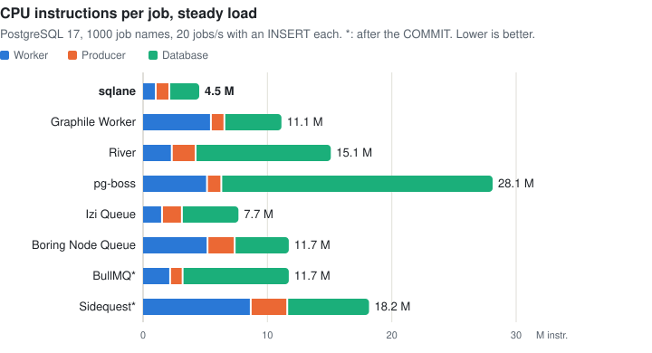
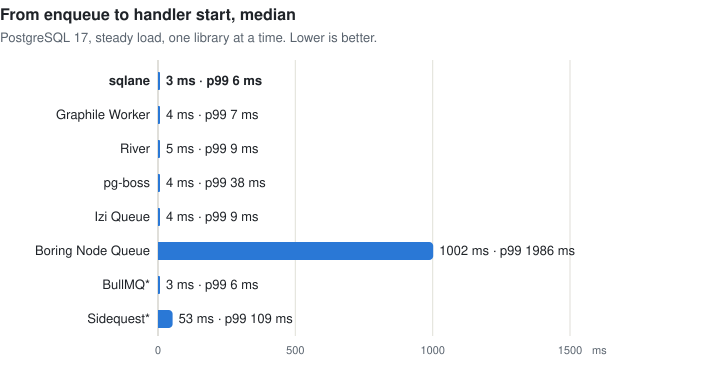
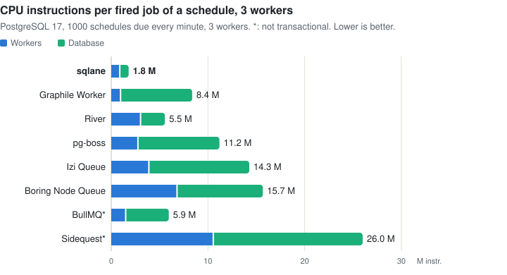

# Performance vs other libraries

What sqlane and seven other job queues for Node.js cost for the same work, with empty handlers, so the numbers are the
cost of the queue itself. The main measure is CPU instructions per job, which doesn't depend on the machine's load.
PostgreSQL 17 unless noted; it is the one database all eight libraries run on. For features, see
[features vs other libraries](features_vs_other_libs.md).

\* BullMQ and Sidequest enqueue after the `COMMIT`, not in the caller's transaction.

## Conditions

- **Measured** on 14 November 2026, on a desktop PC: AMD Ryzen 5 3600 (6 cores, 12 threads), 64 GB, Linux 7.2. The
  databases and the libraries run in one rootless Podman container
  ([linux.dockerfile](../bench/compare/linux.dockerfile)): Debian 13, Node.js 26.13.0, PostgreSQL 17.11, MySQL
  8.4.13, MariaDB 11.8.9 and Redis 8.10.3.
- **Versions:** sqlane 5.0.0, pg-boss 12.38.2, Graphile Worker 0.18.0, River for JavaScript 0.3.2, BullMQ 6.7.4,
  Sidequest 1.17.0, Boring Node Queue 0.9.1, Izi Queue 0.10.0.
- **Workers:** one worker process with 8 concurrent jobs; pg-boss has its slots per queue, so up to 8 per job name.
- **Instructions** are user and kernel instructions of every process of a library and of its database. They come from
  up to 8 runs at once; times come from one library at a time.
- **One run:** differences of about 10% are noise.
- **BullMQ on Redis** syncs its append-only file every second (`appendfsync everysec`), so a crash can lose up to a
  second of jobs.
- **Method:** [bench/compare](../bench/compare/README.md#performance), which also says how to reproduce it.

Settings changed from each library's defaults, as its documentation offers for throughput:

| Library   | Setting                                                                          | Default                     |
| --------- | -------------------------------------------------------------------------------- | --------------------------- |
| River     | `fetchCooldown: 1 ms`                                                            | 100 ms                      |
| pg-boss   | `batchSize: 8`, `burstWhenBatchFull: true`                                       | 1, off                      |
| pg-boss   | `useListenNotify`, `notify` on each queue                                        | off                         |
| pg-boss   | `cronWorkerIntervalSeconds: 1`                                                   | 5 s                         |
| Izi Queue | `pollInterval: 100 ms`                                                           | 1 s                         |
| Izi Queue | CronPlugin `interval: 1 s`                                                       | 60 s                        |
| Sidequest | Schedules registered in one worker only ([cron](features_vs_other_libs.md#cron)) | every worker registers them |

## Steady load

A producer enqueues 20 jobs per second, each in a transaction with an `INSERT` into a business table. 9 of 10 jobs go
to 10 of the 1000 job names. Instructions per job, in the worker, the producer and the database:

<picture>
  <source media="(prefers-color-scheme: dark)" srcset="https://raw.githubusercontent.com/sqlane/sqlane-node/main/docs/images/perf_cpu_per_job_dark.svg">
  
</picture>

| Library           | Database     | Instructions (M) | Worker / producer / database | CPU ms |
| ----------------- | ------------ | ---------------- | ---------------------------- | ------ |
| sqlane            | PostgreSQL   | **3.4**          | 1.0 / 0.9 / 1.6              | 1.5    |
| Izi Queue         | PostgreSQL   | 6.3              | 1.6 / 1.3 / 3.4              | 2.0    |
| BullMQ\*          | PostgreSQL   | 9.6              | 1.8 / 0.8 / 7.1              | 3.2    |
| Graphile Worker   | PostgreSQL   | 9.9              | 5.4 / 0.7 / 3.8              | 2.1    |
| Boring Node Queue | PostgreSQL   | 10.0             | 5.0 / 2.0 / 3.1              | 3.0    |
| River             | PostgreSQL   | 13.4             | 2.3 / 1.4 / 9.8              | 3.5    |
| Sidequest\*       | PostgreSQL   | 16.2             | 8.1 / 2.5 / 5.5              | 4.5    |
| pg-boss           | PostgreSQL   | 23.9             | 4.2 / 0.9 / 18.8             | 6.6    |
| BullMQ\*          | Redis ¹      | 4.2              | 1.8 / 0.8 / 1.6              | 1.6    |
| Izi Queue         | MySQL 8.4    | 6.1              | 1.8 / 1.0 / 3.4              | —      |
| sqlane            | MySQL 8.4    | 9.2              | 2.4 / 1.1 / 5.7              | —      |
| Boring Node Queue | MySQL 8.4    | 11.3             | 5.3 / 2.0 / 4.0              | —      |
| Sidequest\*       | MySQL 8.4    | 20.1             | 9.8 / 3.7 / 6.6              | —      |
| sqlane            | MariaDB 11.8 | 7.2              | 2.4 / 1.1 / 3.7              | —      |
| Boring Node Queue | MariaDB 11.8 | 10.1             | 5.3 / 2.0 / 2.9              | —      |

1. Redis 8.10 for the queue, PostgreSQL for the business table.

On PostgreSQL, the other libraries use 1.9–7.0× as many instructions per job as sqlane.
On MySQL, Izi Queue uses fewer than sqlane.
CPU time is given only for the runs with one library at a time.

## Latency

From the enqueue to the start of the handler, one library at a time. For BullMQ and Sidequest, the enqueue comes after
the `COMMIT`.

<picture>
  <source media="(prefers-color-scheme: dark)" srcset="https://raw.githubusercontent.com/sqlane/sqlane-node/main/docs/images/perf_latency_dark.svg">
  
</picture>

| Library           | Database   | p50 (ms) | p99 (ms) | Wake-up                    |
| ----------------- | ---------- | -------- | -------- | -------------------------- |
| sqlane            | PostgreSQL | 1        | 1        | LISTEN/NOTIFY              |
| BullMQ\*          | Redis      | 1        | 1        | Redis                      |
| Graphile Worker   | PostgreSQL | 1        | 2        | LISTEN/NOTIFY              |
| BullMQ\*          | PostgreSQL | 1        | 2        | —                          |
| Izi Queue         | PostgreSQL | 1        | 2        | LISTEN/NOTIFY              |
| River             | PostgreSQL | 2        | 3        | LISTEN/NOTIFY              |
| pg-boss           | PostgreSQL | 2        | 27       | LISTEN/NOTIFY              |
| Sidequest\*       | PostgreSQL | 53       | 103      | Poll every 100 ms          |
| Boring Node Queue | PostgreSQL | 999      | 1,985    | Poll every 2 s when idle ² |

2. Boring Node Queue 0.10.0 adds LISTEN/NOTIFY; it was less than 7 days old at the time of the run.

## Idle

No jobs, nothing due. Per second, with 1 and with 1000 job names:

<picture>
  <source media="(prefers-color-scheme: dark)" srcset="https://raw.githubusercontent.com/sqlane/sqlane-node/main/docs/images/perf_idle_dark.svg">
  
</picture>

| Library           | Database   | Database instructions (M), 1 / 1000 names | Worker instructions (M), 1 / 1000 names | SQL statements, 1000 names | Connections |
| ----------------- | ---------- | ----------------------------------------- | --------------------------------------- | -------------------------- | ----------- |
| sqlane            | PostgreSQL | 0.0 / 0.0                                 | 0.2 / 0.3                               | 0.2                        | 2           |
| BullMQ            | PostgreSQL | 0.8 / 0.8                                 | 0.6 / 0.6                               | 0.8                        | 4           |
| Boring Node Queue | PostgreSQL | 0.8 / 0.8                                 | 2.9 / 3.0                               | 4.8                        | 1           |
| River             | PostgreSQL | 1.3 / 1.4                                 | 8.1 / 2.9                               | 2.1                        | 5           |
| Sidequest         | PostgreSQL | 1.6 / 1.6                                 | 5.3 / 5.5                               | 9.9                        | 3           |
| Graphile Worker   | PostgreSQL | 0.8 / 1.8                                 | 1.7 / 5.0                               | 1.6                        | 5           |
| Izi Queue         | PostgreSQL | 12.7 / 12.7                               | 6.9 / 6.6                               | 11.2                       | 2           |
| pg-boss           | PostgreSQL | 4.6 / **256.2**                           | 2.4 / **66.9**                          | **203.6**                  | 6           |
| BullMQ            | Redis      | 2.8 / 2.9                                 | 0.3 / 0.3                               | —                          | —           |
| sqlane            | MySQL      | 1.9 / 1.8                                 | 0.9 / 1.0                               | —                          | —           |
| Boring Node Queue | MySQL      | 2.6 / 2.6                                 | 4.1 / 4.1                               | —                          | —           |
| Sidequest         | MySQL      | 2.7 / 3.2                                 | 6.3 / 6.3                               | —                          | —           |
| Izi Queue         | MySQL      | 12.6 / 12.5                               | 14.4 / 10.2                             | —                          | —           |
| sqlane            | MariaDB    | 0.1 / 0.1                                 | 0.2 / 1.0                               | —                          | —           |
| Boring Node Queue | MariaDB    | 0.6 / 0.6                                 | 4.0 / 4.1                               | —                          | —           |

pg-boss, with a queue per job name, runs about 204 statements per second for 1000 idle names. On MySQL
and MariaDB the database figure is the whole server process, so the idle numbers there are noisy.

## Drain

10,000 due jobs over the 1000 job names, enqueued before the worker starts: the time until the worker has run them
all, one library at a time, stopped after 60 s.

<picture>
  <source media="(prefers-color-scheme: dark)" srcset="https://raw.githubusercontent.com/sqlane/sqlane-node/main/docs/images/perf_drain_dark.svg">
   60 s, stopped, Boring Node Queue 12.3 s, BullMQ 1.2 s (after the commit), Sidequest 15.4 s (after the commit), BullMQ (Redis) 0.6 s (after the commit)" src="https://raw.githubusercontent.com/sqlane/sqlane-node/main/docs/images/perf_drain_light.svg">
</picture>

| Library           | Database   | Time     | Jobs at once | Instructions per job (M), worker / database = total |
| ----------------- | ---------- | -------- | ------------ | --------------------------------------------------- |
| pg-boss           | PostgreSQL | 0.5 s    | up to 8,000  | 0.4 / 0.8 = 1.2                                     |
| BullMQ\*          | Redis      | 0.6 s    | 8            | 0.5 / 0.4 = 1.0                                     |
| BullMQ\*          | PostgreSQL | 1.2 s    | 8            | 0.5 / 2.0 = 2.5                                     |
| sqlane            | PostgreSQL | 1.9 s    | 8            | 0.5 / 1.0 = 1.5                                     |
| Graphile Worker   | PostgreSQL | 2.8 s    | 8            | 2.5 / 1.1 = 3.6                                     |
| River             | PostgreSQL | 6.0 s    | 8            | 0.8 / 5.8 = 6.6                                     |
| Boring Node Queue | PostgreSQL | 12.3 s   | 8            | 3.3 / 2.4 = 5.6                                     |
| Sidequest\*       | PostgreSQL | 15.4 s   | 8            | 5.3 / 9.4 = 14.6                                    |
| Izi Queue         | PostgreSQL | > 60 s ³ | 8            | 0.8 / 6.5 = 7.3                                     |

3. Stopped after 60 s, when 4,552 jobs had run; its instructions are per job that ran.

MySQL and MariaDB have no drain times: their drains ran only alongside other libraries, and a drain's time and cost
change with the others' load.

## Schedules

1000 cron schedules due every minute (`* * * * *`), of one job name, with 1 and with 3 worker processes. CPU of all
the processes and the database per fired job, the median of 3 runs. In every run, every library added each of the 2000
slots exactly once.

<picture>
  <source media="(prefers-color-scheme: dark)" srcset="https://raw.githubusercontent.com/sqlane/sqlane-node/main/docs/images/perf_cron_dark.svg">
  
</picture>

| Library           | Database   | Workers | Instructions per job (M), workers / database = total | Range of 3 runs | Statements per job |
| ----------------- | ---------- | ------- | ---------------------------------------------------- | --------------- | ------------------ |
| sqlane            | PostgreSQL | 1       | 0.5 / 1.2 = **1.6**                                  | 1.1–1.6         | 0.33               |
| sqlane            | PostgreSQL | 3       | 1.0 / 0.8 = **1.8**                                  | 1.7–1.8         | 0.45               |
| sqlane            | MySQL      | 1       | 0.6 / 1.5 = 2.1                                      | 2.0–2.2         | —                  |
| sqlane            | MySQL      | 3       | 0.6 / 1.5 = 2.1                                      | 2.0–2.2         | —                  |
| Graphile Worker   | PostgreSQL | 1       | 0.6 / 6.7 = 7.3                                      | 7.2–7.4         | 2.10               |
| Graphile Worker   | PostgreSQL | 3       | 1.0 / 7.3 = 8.4                                      | 8.4–8.4         | 2.29               |
| River             | PostgreSQL | 1       | 2.5 / 2.2 = 4.7                                      | 4.7–4.8         | 0.29               |
| River             | PostgreSQL | 3       | 3.1 / 2.4 = 5.5                                      | 5.5–5.6         | 0.44               |
| pg-boss           | PostgreSQL | 1       | 1.7 / 5.3 = 7.0                                      | 6.9–12.5        | 3.70               |
| pg-boss           | PostgreSQL | 3       | 2.8 / 8.4 = 11.2                                     | 10.2–11.2       | 6.00               |
| Izi Queue         | PostgreSQL | 1       | 2.3 / 5.9 = 8.2                                      | 8.2–9.6         | 13.64              |
| Izi Queue         | PostgreSQL | 3       | 4.0 / 10.3 = 14.3                                    | 14.2–14.8       | 16.78              |
| Izi Queue         | MySQL      | 1       | 3.7 / 5.5 = 9.2                                      | 9.2–9.6         | —                  |
| Izi Queue         | MySQL      | 3       | 4.4 / 5.6 = 10.0                                     | 9.8–10.4        | —                  |
| Boring Node Queue | PostgreSQL | 1       | 5.8 / 8.4 = 14.2                                     | 14.2–14.3       | 16.30              |
| Boring Node Queue | PostgreSQL | 3       | 6.9 / 8.8 = 15.7                                     | 12.9–15.9       | 16.93              |
| Boring Node Queue | MySQL      | 1       | 5.5 / 4.8 = 10.2                                     | 10.2–10.6       | —                  |
| Boring Node Queue | MySQL      | 3       | 6.8 / 5.3 = 12.1                                     | 11.9–12.2       | —                  |
| BullMQ\*          | Redis      | 1       | 1.9 / 1.1 = 2.9                                      | 2.9–2.9         | —                  |
| BullMQ\*          | Redis      | 3       | 2.3 / 1.0 = 3.3                                      | 3.3–3.3         | —                  |
| BullMQ\*          | PostgreSQL | 1       | 1.3 / 3.6 = 4.9                                      | 4.9–5.0         | 2.02               |
| BullMQ\*          | PostgreSQL | 3       | 1.6 / 4.4 = 5.9                                      | 5.6–6.0         | 2.08               |
| Sidequest\*       | PostgreSQL | 1       | 7.8 / 7.7 = 15.5                                     | 15.5–15.6       | 7.83               |
| Sidequest\*       | PostgreSQL | 3       | 10.6 / 15.4 = 26.0                                   | 25.8–26.9       | 13.70              |
| Sidequest\*       | MySQL      | 1       | 9.7 / 9.0 = 18.7                                     | 18.6–18.7       | —                  |
| Sidequest\*       | MySQL      | 3       | 12.0 / 21.2 = 33.2                                   | 32.9–33.8       | —                  |

With 3 workers on PostgreSQL, the other libraries use 3.1–14.4× as many
instructions per fired job as sqlane.

### Idle schedules

No slot due, 1 worker, no jobs. A daily cron 12 hours away, and a yearly one. Per second:

| Library           | Database   | Schedules | Cron   | Database instructions (M) | Worker instructions (M) | SQL statements | Connections |
| ----------------- | ---------- | --------- | ------ | ------------------------- | ----------------------- | -------------- | ----------- |
| sqlane            | PostgreSQL | 1         | daily  | 0.1                       | 0.2                     | 0.4            | 2           |
| sqlane            | PostgreSQL | 1000      | daily  | 0.1                       | 1.0                     | 0.4            | 2           |
| Graphile Worker   | PostgreSQL | 1         | daily  | 0.4                       | 1.1                     | 1.6            | 5           |
| Graphile Worker   | PostgreSQL | 1000      | daily  | 0.4                       | 1.6                     | 1.6            | 5           |
| River             | PostgreSQL | 1         | daily  | 1.3                       | 3.7                     | 2.4            | 5           |
| River             | PostgreSQL | 1000      | daily  | 1.3                       | 6.3                     | 2.4            | 5           |
| pg-boss           | PostgreSQL | 1         | daily  | 5.2                       | 3.5                     | 4.3            | 6           |
| pg-boss           | PostgreSQL | 1000      | daily  | 5.8                       | 29.1                    | 4.2            | 6           |
| pg-boss           | PostgreSQL | 1000      | yearly | 5.7                       | 188.5                   | 4.2            | 6           |
| Izi Queue         | PostgreSQL | 1         | daily  | 12.6                      | 4.1                     | 11.2           | 3           |
| Izi Queue         | PostgreSQL | 1000      | daily  | 12.6                      | 6.4                     | 11.2           | 3           |
| Boring Node Queue | PostgreSQL | 1         | daily  | 0.7                       | 3.7                     | 4.6            | 1           |
| Boring Node Queue | PostgreSQL | 1000      | daily  | 0.7                       | 3.7                     | 4.6            | 1           |
| BullMQ\*          | Redis      | 1         | daily  | 2.7                       | 1.0                     | —              | —           |
| BullMQ\*          | Redis      | 1000      | daily  | 2.7                       | 1.0                     | —              | —           |
| BullMQ\*          | PostgreSQL | 1         | daily  | 0.0                       | 0.8                     | 0.0            | 4           |
| BullMQ\*          | PostgreSQL | 1000      | daily  | 0.1                       | 0.9                     | 0.0            | 4           |
| Sidequest\*       | PostgreSQL | 1         | daily  | 1.6                       | 5.5                     | 9.9            | 2           |
| Sidequest\*       | PostgreSQL | 1000      | daily  | 1.6                       | 5.4                     | 9.9            | 2           |

The other libraries cost about the same with a yearly cron as with a daily one (within 0.5 M per second).
