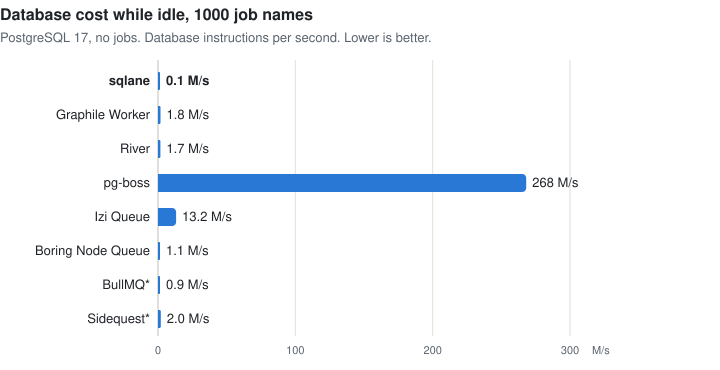
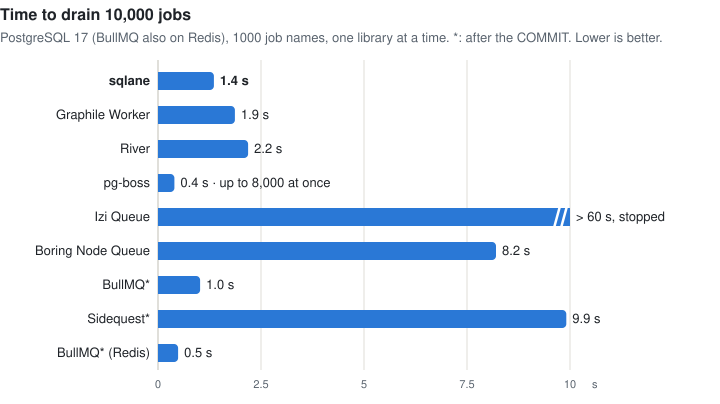

# Performance vs other libraries

What sqlane and seven other job queues for Node.js cost for the same work, with empty handlers, so the numbers are the
cost of the queue itself. The main measure is CPU instructions per job, which doesn't depend on the machine's load.
PostgreSQL 17 unless noted; it is the one database all eight libraries run on. For features, see
[features vs other libraries](features_vs_other_libs.md).

\* BullMQ and Sidequest enqueue after the `COMMIT`, not in the caller's transaction.

## Conditions

- **Measured** on 12 November 2026, on an Apple M1 Pro (8 cores, 16 GiB), macOS 27.2, Node.js 26.13.0, with
  PostgreSQL 17.11, MySQL 8.4.13, MariaDB 11.8.9 and Redis 8.10.3 from Homebrew.
- **Versions:** sqlane 4.0.1, pg-boss 12.38.2, Graphile Worker 0.18.0, River for JavaScript 0.3.2, BullMQ 6.7.4,
  Sidequest 1.17.0, Boring Node Queue 0.9.1, Izi Queue 0.10.0.
- **Workers:** one worker process with 8 concurrent jobs; pg-boss has its slots per queue, so up to 8 per job name.
- **One run:** differences of about 10% are noise. Instructions come from all the libraries running at once, times
  from one library at a time.
- **BullMQ on Redis** syncs its append-only file every second (`appendfsync everysec`), so a crash can lose up to a
  second of jobs.
- **Method:** [bench/compare](../bench/compare/README.md#performance). To reproduce: `pnpm bench:compare --only perf`
  (about 9 minutes) and `pnpm bench:compare --only cron` (about 9.5 minutes).

Settings changed from each library's defaults, as its documentation offers for throughput:

| Library   | Setting                                    | Default | With the default                                                         |
| --------- | ------------------------------------------ | ------- | ------------------------------------------------------------------------ |
| River     | `fetchCooldown: 1 ms`                      | 100 ms  | 11.8 M instructions per job, 57 ms latency (p50), 126 s drain            |
| pg-boss   | `batchSize: 8`, `burstWhenBatchFull: true` | 1, off  | 45 s drain                                                               |
| pg-boss   | `useListenNotify`, `notify` on each queue  | off     | —                                                                        |
| pg-boss   | `cronWorkerIntervalSeconds: 1`             | 5 s     | at most 600 cron jobs a minute per instance: 1000 schedules fell behind  |
| Izi Queue | `pollInterval: 100 ms`                     | 1 s     | 8 jobs a second, below the 20 of the steady load                         |
| Izi Queue | CronPlugin `interval: 1 s`                 | 60 s    | a minute is evaluated up to 60 s late                                    |
| Sidequest | Schedules registered in one worker only    | all     | every worker enqueues every run ([cron](features_vs_other_libs.md#cron)) |

## Steady load

A producer enqueues 20 jobs per second, each in a transaction with an `INSERT` into a business table. 9 of 10 jobs go
to 10 of the 1000 job names. Instructions per job, in the worker, the producer and the database:

<picture>
  <source media="(prefers-color-scheme: dark)" srcset="https://raw.githubusercontent.com/sqlane/sqlane-node/main/docs/images/perf_cpu_per_job_dark.svg">
  
</picture>

| Library           | Database     | Instructions (M) | Worker / producer / database | CPU ms |
| ----------------- | ------------ | ---------------- | ---------------------------- | ------ |
| sqlane            | PostgreSQL   | **4.5**          | 1.1 / 1.1 / 2.3              | 4.9    |
| Izi Queue         | PostgreSQL   | 7.7              | 1.6 / 1.6 / 4.5              | 6.0    |
| Graphile Worker   | PostgreSQL   | 11.1             | 5.5 / 1.1 / 4.5              | 6.5    |
| Boring Node Queue | PostgreSQL   | 11.7             | 5.3 / 2.2 / 4.3              | 5.7    |
| BullMQ\*          | PostgreSQL   | 11.7             | 2.2 / 1.0 / 8.5              | 8.6    |
| River             | PostgreSQL   | 15.1             | 2.4 / 1.9 / 10.8             | 8.5    |
| Sidequest\*       | PostgreSQL   | 18.2             | 8.7 / 2.9 / 6.5              | 10.3   |
| pg-boss           | PostgreSQL   | 28.1             | 5.2 / 1.2 / 21.7             | 8.6    |
| BullMQ\*          | Redis ¹      | 5.7              | 2.4 / 1.1 / 2.3              | 5.7    |
| Izi Queue         | MySQL 8.4    | 9.1              | 2.0 / 1.1 / 6.0              | —      |
| sqlane            | MySQL 8.4    | 14.4             | 3.1 / 1.6 / 9.7              | —      |
| Boring Node Queue | MySQL 8.4    | 15.2             | 5.8 / 2.1 / 7.3              | —      |
| Sidequest\*       | MySQL 8.4    | 25.8             | 10.6 / 4.2 / 11.0            | —      |
| sqlane            | MariaDB 11.8 | 10.5             | 3.2 / 1.6 / 5.7              | —      |
| Boring Node Queue | MariaDB 11.8 | 11.7             | 5.4 / 2.0 / 4.2              | —      |

1. Redis 8.10 for the queue, PostgreSQL for the business table.

On PostgreSQL, the other libraries use 1.7–6.2× as many instructions per job as sqlane. On MySQL, Izi Queue uses fewer
than sqlane. CPU time is given only for the runs with one library at a time.

## Latency

From the enqueue to the start of the handler, one library at a time. For BullMQ and Sidequest, the enqueue comes after
the `COMMIT`.

<picture>
  <source media="(prefers-color-scheme: dark)" srcset="https://raw.githubusercontent.com/sqlane/sqlane-node/main/docs/images/perf_latency_dark.svg">
  
</picture>

| Library           | Database   | p50 (ms) | p99 (ms) | Wake-up                    |
| ----------------- | ---------- | -------- | -------- | -------------------------- |
| BullMQ\*          | Redis      | 2        | 6        | Redis                      |
| sqlane            | PostgreSQL | 3        | 6        | LISTEN/NOTIFY              |
| BullMQ\*          | PostgreSQL | 3        | 6        | —                          |
| Izi Queue         | PostgreSQL | 4        | 9        | LISTEN/NOTIFY              |
| Graphile Worker   | PostgreSQL | 4        | 7        | LISTEN/NOTIFY              |
| pg-boss           | PostgreSQL | 4        | 38       | LISTEN/NOTIFY              |
| River             | PostgreSQL | 5        | 9        | LISTEN/NOTIFY              |
| Sidequest\*       | PostgreSQL | 53       | 109      | Poll every 100 ms          |
| Boring Node Queue | PostgreSQL | 1,002    | 1,986    | Poll every 2 s when idle ² |

2. Boring Node Queue 0.10.0, which came out on the day of the run, adds LISTEN/NOTIFY.

## Idle

No jobs, nothing due. Per second, with 1 and with 1000 job names:

<picture>
  <source media="(prefers-color-scheme: dark)" srcset="https://raw.githubusercontent.com/sqlane/sqlane-node/main/docs/images/perf_idle_dark.svg">
  
</picture>

| Library           | Database   | Database instructions (M), 1 / 1000 names | Worker instructions (M), 1 / 1000 names | SQL statements, 1000 names | Connections |
| ----------------- | ---------- | ----------------------------------------- | --------------------------------------- | -------------------------- | ----------- |
| sqlane            | PostgreSQL | 0.5 / 0.1                                 | 0.6 / 0.6                               | 0.2                        | 2           |
| BullMQ            | PostgreSQL | 0.8 / 0.9                                 | 0.7 / 0.8                               | 0.8                        | 4           |
| Boring Node Queue | PostgreSQL | 1.1 / 1.1                                 | 3.4 / 3.4                               | 4.7                        | 1           |
| River             | PostgreSQL | 2.2 / 1.7                                 | 3.7 / 3.7                               | 2.1                        | 5           |
| Graphile Worker   | PostgreSQL | 0.8 / 1.8                                 | 1.5 / 5.2                               | 1.6                        | 5           |
| Sidequest         | PostgreSQL | 2.0 / 2.0                                 | 6.1 / 6.1                               | 9.7                        | 3           |
| Izi Queue         | PostgreSQL | 14.0 / 13.2                               | 7.6 / 7.6                               | 11.0                       | 2           |
| pg-boss           | PostgreSQL | 5.0 / **268.1**                           | 3.2 / **72.6**                          | **200.3**                  | 6           |
| BullMQ            | Redis      | 0.9 / 1.2                                 | 0.4 / 0.4                               | —                          | —           |
| sqlane            | MySQL      | 3.5 / 3.8                                 | 1.3 / 6.5                               | —                          | —           |
| Sidequest         | MySQL      | 4.3 / 5.4                                 | 7.0 / 7.2                               | —                          | —           |
| Boring Node Queue | MySQL      | 4.8 / 5.9                                 | 4.6 / 4.7                               | —                          | —           |
| Izi Queue         | MySQL      | 18.8 / 19.9                               | 14.6 / 16.3                             | —                          | —           |
| sqlane            | MariaDB    | 0.1 / 0.2                                 | 0.8 / 1.6                               | —                          | —           |
| Boring Node Queue | MariaDB    | 0.9 / 0.9                                 | 4.6 / 4.8                               | —                          | —           |

pg-boss, with a queue per job name, runs 200 statements per second for 1000 idle names, about 4% of a core. On MySQL
and MariaDB the database figure is the whole server process, so the idle numbers there are noisy.

## Drain

10,000 due jobs over the 1000 job names, enqueued before the worker starts: the time until the worker has run them
all, one library at a time, stopped after 60 s.

<picture>
  <source media="(prefers-color-scheme: dark)" srcset="https://raw.githubusercontent.com/sqlane/sqlane-node/main/docs/images/perf_drain_dark.svg">
  
</picture>

| Library           | Database   | Time     | Jobs at once | Instructions per job (M), worker / database = total |
| ----------------- | ---------- | -------- | ------------ | --------------------------------------------------- |
| pg-boss           | PostgreSQL | 0.4 s    | up to 8,000  | 0.4 / 1.1 = 1.5                                     |
| BullMQ\*          | Redis      | 0.5 s    | 8            | 0.6 / 0.5 = 1.1                                     |
| BullMQ\*          | PostgreSQL | 1.0 s    | 8            | 0.6 / 2.4 = 3.0                                     |
| sqlane            | PostgreSQL | 1.4 s    | 8            | 0.5 / 0.7 = 1.2                                     |
| Graphile Worker   | PostgreSQL | 1.9 s    | 8            | 2.6 / 3.3 = 6.0                                     |
| River             | PostgreSQL | 2.2 s    | 8            | 0.8 / 0.8 = 1.6                                     |
| Boring Node Queue | PostgreSQL | 8.2 s    | 8            | 3.8 / 3.1 = 6.9                                     |
| Sidequest\*       | PostgreSQL | 9.9 s    | 8            | 5.7 / 8.8 = 14.5                                    |
| Izi Queue         | PostgreSQL | > 60 s ³ | 8            | 1.1 / 6.7 = 7.8                                     |

3. Stopped after 60 s, when 4,296 jobs had run; its instructions are per job that ran.

MySQL and MariaDB have no drain numbers: those runs only ran with all the libraries at once, and a drain's cost
changes with the others' load.

## Schedules

1000 cron schedules due every minute (`* * * * *`), of one job name, with 1 and with 3 worker processes. CPU of all
the processes and the database per fired job, the median of 3 runs. In every run, every library added each of the 2000
slots exactly once.

<picture>
  <source media="(prefers-color-scheme: dark)" srcset="https://raw.githubusercontent.com/sqlane/sqlane-node/main/docs/images/perf_cron_dark.svg">
  
</picture>

| Library           | Database   | Workers | Instructions per job (M), workers / database = total | Range of 3 runs | Statements per job |
| ----------------- | ---------- | ------- | ---------------------------------------------------- | --------------- | ------------------ |
| sqlane            | PostgreSQL | 1       | 0.6 / 1.1 = **1.7**                                  | 1.3–1.7         | 0.32               |
| sqlane            | PostgreSQL | 3       | 1.2 / 0.9 = **2.1**                                  | 2.1–2.2         | 0.44               |
| sqlane            | MySQL      | 1       | 0.9 / 2.3 = 3.2                                      | 3.2–3.2         | —                  |
| sqlane            | MySQL      | 3       | 0.9 / 2.3 = 3.1                                      | 3.1–3.2         | —                  |
| Graphile Worker   | PostgreSQL | 1       | 0.9 / 6.6 = 7.5                                      | 7.4–7.5         | 2.10               |
| Graphile Worker   | PostgreSQL | 3       | 1.4 / 7.4 = 8.8                                      | 8.8–9.1         | 2.29               |
| River             | PostgreSQL | 1       | 2.5 / 2.2 = 4.7                                      | 4.7–4.8         | 0.30               |
| River             | PostgreSQL | 3       | 3.3 / 2.4 = 5.7                                      | 5.7–5.8         | 0.44               |
| pg-boss           | PostgreSQL | 1       | 2.0 / 6.2 = 8.2                                      | 8.1–8.5         | 3.71               |
| pg-boss           | PostgreSQL | 3       | 3.5 / 12.0 = 15.4 ⁴                                  | 10.4–17.3       | 8.40               |
| Izi Queue         | PostgreSQL | 1       | 11.3 / 21.0 = 32.3                                   | 26.5–33.8       | 69.56              |
| Izi Queue         | PostgreSQL | 3       | 12.7 / 24.3 = 37.0                                   | 30.7–40.4       | 68.39              |
| Izi Queue         | MySQL      | 1       | 17.6 / 28.3 = 46.0                                   | 36.6–60.1       | —                  |
| Izi Queue         | MySQL      | 3       | 19.1 / 29.1 = 48.2                                   | 36.6–62.6       | —                  |
| Boring Node Queue | PostgreSQL | 1       | 6.9 / 9.1 = 16.0                                     | 12.2–16.1       | 16.25              |
| Boring Node Queue | PostgreSQL | 3       | 8.2 / 9.9 = 18.1                                     | 18.1–18.3       | 16.85              |
| Boring Node Queue | MySQL      | 1       | 7.0 / 9.0 = 16.0                                     | 15.8–16.0       | —                  |
| Boring Node Queue | MySQL      | 3       | 8.6 / 8.9 = 17.5                                     | 17.2–18.4       | —                  |
| BullMQ\*          | Redis      | 1       | 1.6 / 1.1 = 2.6                                      | 2.6–2.7         | —                  |
| BullMQ\*          | Redis      | 3       | 2.2 / 1.1 = 3.3                                      | 3.0–3.3         | —                  |
| BullMQ\*          | PostgreSQL | 1       | 1.5 / 4.8 = 6.3                                      | 6.2–6.4         | 2.02               |
| BullMQ\*          | PostgreSQL | 3       | 2.1 / 6.0 = 8.1                                      | 7.9–9.4         | 2.07               |
| Sidequest\*       | PostgreSQL | 1       | 8.3 / 8.0 = 16.3                                     | 16.3–16.6       | 7.84               |
| Sidequest\*       | PostgreSQL | 3       | 11.5 / 15.6 = 27.2                                   | 25.7–27.7       | 13.51              |
| Sidequest\*       | MySQL      | 1       | 10.5 / 12.6 = 23.1                                   | 22.9–23.3       | —                  |
| Sidequest\*       | MySQL      | 3       | 13.1 / 22.2 = 35.2                                   | 34.5–36.2       | —                  |

4. pg-boss with 3 workers varied between runs: 9 runs that day gave 10.4–17.3 M per job. The row shows the run with
   the median total.

With 3 workers on PostgreSQL, the other libraries use 2.7–17× as many instructions per fired job as sqlane.

### Idle schedules

No slot due, 1 worker, no jobs. A daily cron 12 hours away, and a yearly one. Per second:

| Library           | Database   | Schedules | Cron   | Database instructions (M) | Worker instructions (M) | SQL statements | Connections |
| ----------------- | ---------- | --------- | ------ | ------------------------- | ----------------------- | -------------- | ----------- |
| sqlane            | PostgreSQL | 1         | daily  | 0.3                       | 0.9                     | 0.4            | 2           |
| sqlane            | PostgreSQL | 1000      | daily  | 0.3                       | 1.8                     | 0.4            | 2           |
| Graphile Worker   | PostgreSQL | 1         | daily  | 1.2                       | 1.9                     | 1.6            | 5           |
| Graphile Worker   | PostgreSQL | 1000      | daily  | 1.3                       | 2.5                     | 1.6            | 5           |
| River             | PostgreSQL | 1         | daily  | 2.0                       | 5.4                     | 2.4            | 5           |
| River             | PostgreSQL | 1000      | daily  | 2.0                       | 8.4                     | 2.4            | 5           |
| pg-boss           | PostgreSQL | 1         | daily  | 7.8                       | 5.5                     | 4.3            | 6           |
| pg-boss           | PostgreSQL | 1000      | daily  | 8.4                       | 25.9                    | 4.3            | 6           |
| pg-boss           | PostgreSQL | 1000      | yearly | 8.5                       | 185.6                   | 4.3            | 6           |
| Izi Queue         | PostgreSQL | 1         | daily  | 13.1                      | 5.2                     | 11.0           | 3           |
| Izi Queue         | PostgreSQL | 1000      | daily  | 13.2                      | 7.4                     | 11.0           | 3           |
| Boring Node Queue | PostgreSQL | 1         | daily  | 1.1                       | 5.4                     | 4.6            | 1           |
| Boring Node Queue | PostgreSQL | 1000      | daily  | 1.1                       | 5.5                     | 4.6            | 1           |
| BullMQ\*          | Redis      | 1         | daily  | 0.7                       | 1.6                     | —              | —           |
| BullMQ\*          | Redis      | 1000      | daily  | 0.7                       | 1.6                     | —              | —           |
| BullMQ\*          | PostgreSQL | 1         | daily  | 0.2                       | 1.3                     | 0.0            | 4           |
| BullMQ\*          | PostgreSQL | 1000      | daily  | 0.2                       | 1.4                     | 0.0            | 4           |
| Sidequest\*       | PostgreSQL | 1         | daily  | 1.9                       | 6.2                     | 9.7            | 2           |
| Sidequest\*       | PostgreSQL | 1000      | daily  | 1.9                       | 7.6                     | 9.7            | 2           |

The other libraries cost about the same with a yearly cron as with a daily one (within 1.3 M per second).
