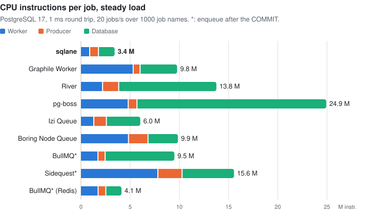
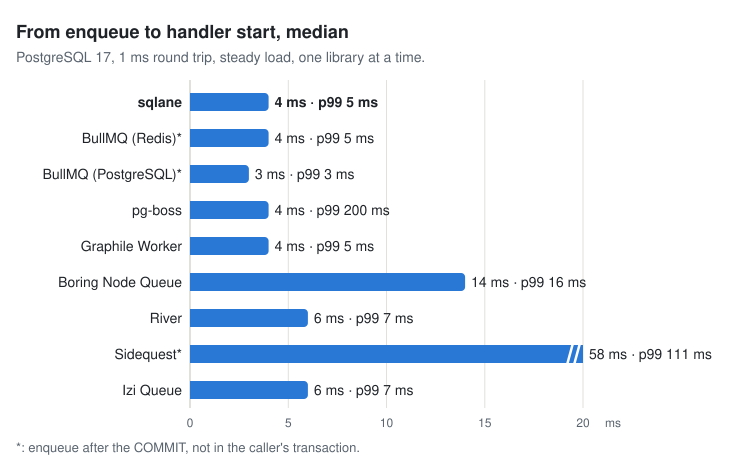
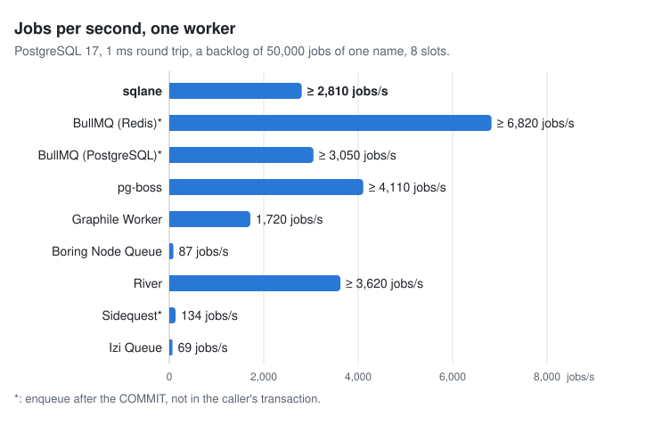
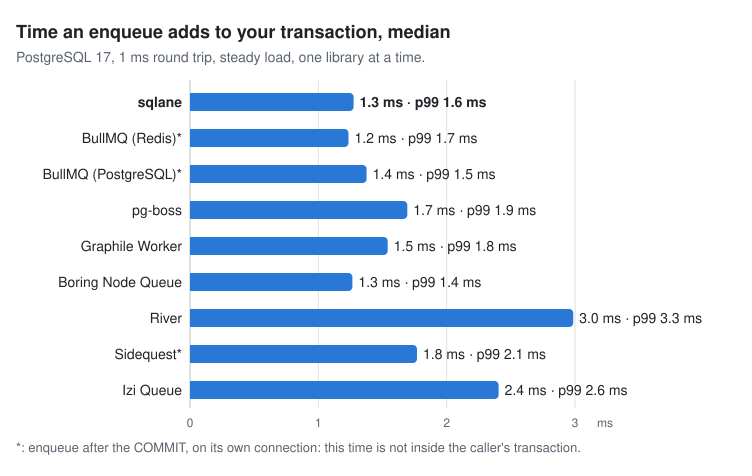
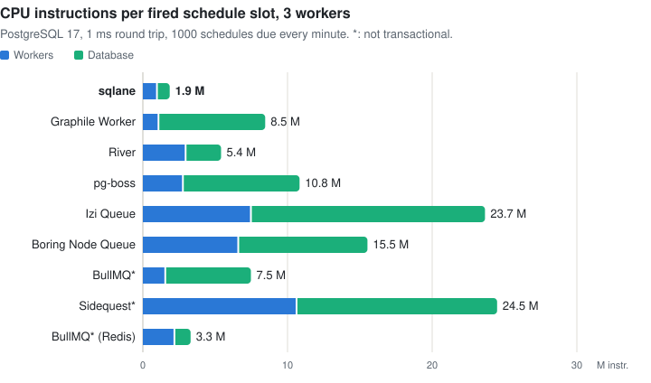

# Performance vs other libraries

The cost of the queue itself: sqlane and seven other job queues for Node.js do the same work with empty handlers, on
PostgreSQL 17 (BullMQ also on Redis), with a 1 ms round trip between each process and its database, as inside one
cloud availability zone. For features, see [features vs other libraries](features_vs_other_libs.md).

- **Measured:** CPU and SQL statements per job, the cost of idle job names, the time from enqueue to start, the
  highest rate of one worker with a backlog (throughput), the time an enqueue adds to the caller's transaction, the
  connections and memory of a worker, and the cost of cron schedules.
- **Not measured:** failover, and handlers that do real work. Apart from the throughput, the load is a steady 20 jobs
  per second: those numbers show what each job costs, not how many jobs a machine can run.

\* BullMQ and Sidequest enqueue after the `COMMIT`, not in the caller's transaction.

<!-- generated:conditions -->

- **Measured** on 18 November 2026, on an AMD Ryzen 5 3600 (6 cores, 12 threads), 64 GB, Linux 7.2. The databases and
  the libraries run in one container ([linux.dockerfile](../bench/compare/linux.dockerfile)): Debian 13, Node.js
  26.13.0, PostgreSQL 17.11 and Redis 8.10.3.
- **Versions:** sqlane 7.0.0, BullMQ 6.7.4, pg-boss 12.38.2, Graphile Worker 0.18.0, Boring Node Queue 0.10.0, River for
  JavaScript 0.3.2, Sidequest 1.17.0, Izi Queue 0.10.0.
- **Network:** 0.5 ms each way on the container's loopback (netem), so each round trip between a process and its
  database takes 1 ms.
- **Workers:** one worker process with 8 concurrent jobs; pg-boss has its slots per queue, so up to 8 per job name.
- **Instructions** are user and kernel instructions of every process of a library and of its database. They come from up
  to 9 runs at once; times come from one library at a time.
- **Runs:** 3 of each workload for the instructions and statements, one for the latencies, one for the throughput, one
  for the schedules; the numbers of several runs are medians. The runs of a library differ by at most 6% in instructions
  per job (Boring Node Queue) and 54% in idle instructions per second (sqlane).
- **BullMQ on Redis** syncs its append-only file every second (`appendfsync everysec`), so a crash can lose up to a
  second of jobs.

<!-- /generated:conditions -->

The largest differences between the runs of a library are in the database's instructions alone, with the same
statements and the same CPU in the library's processes: periodic work of the PostgreSQL server falls in some windows
and not in others. It hits sqlane and BullMQ on PostgreSQL the most; the medians keep the typical run.

Settings changed from each library's defaults, sqlane's included, as its documentation offers for throughput. A faster
poll cuts the latency, but raises the idle cost:

| Library           | Setting                                                                                    | Default                         |
| ----------------- | ------------------------------------------------------------------------------------------ | ------------------------------- |
| sqlane            | `notify: true` on the pg adapter: NOTIFY wakes the other processes                         | off: a hint, or the poll        |
| pg-boss           | `batchSize: 8`, `burstWhenBatchFull: true`                                                 | 1, off                          |
| pg-boss           | `useListenNotify`, `notify` on each queue                                                  | off                             |
| pg-boss           | A queue per job name, its usual setup: each of the 1000 `work()` calls polls its own queue | —                               |
| pg-boss           | `cronWorkerIntervalSeconds: 1`                                                             | 5 s                             |
| Boring Node Queue | `notifications: true` on its Knex adapter: LISTEN/NOTIFY wakes the workers                 | off: a poll every 2 s when idle |
| River             | `fetchCooldown: 1 ms`                                                                      | 100 ms                          |
| Sidequest         | Schedules registered in one worker only ([cron](features_vs_other_libs.md#cron))           | every worker registers them     |
| Izi Queue         | `pollInterval: 100 ms`                                                                     | 1 s                             |
| Izi Queue         | CronPlugin `interval: 1 s`                                                                 | 60 s                            |

## CPU per job

A producer enqueues 20 jobs per second, each in a transaction with an `INSERT` into a business table, over 1000 job
names. CPU instructions per job, in the worker, the producer and the database:

<!-- generated:cpu -->

<picture>
  <source media="(prefers-color-scheme: dark)" srcset="https://raw.githubusercontent.com/sqlane/sqlane-node/main/docs/images/perf_cpu_per_job_dark.svg">
  
</picture>

On PostgreSQL, the other libraries use 1.9–9.7× as many instructions per job as sqlane (3.1 M). BullMQ on Redis uses
3.9 M (1.3×), after the commit.

<!-- /generated:cpu -->

## Statements per job

The SQL statements per job of the same steady load, without the business `INSERT` and its transaction. Each one is a
round trip to the database. BullMQ on Redis: Redis commands per job, most of them inside Lua scripts, so fewer
round trips.

<!-- generated:statements -->

<picture>
  <source media="(prefers-color-scheme: dark)" srcset="https://raw.githubusercontent.com/sqlane/sqlane-node/main/docs/images/perf_statements_dark.svg">
  
</picture>

sqlane runs 3.0 statements per job, the others 3.7–25.8; BullMQ on Redis, per job: 60 Redis commands, most inside 5 Lua
script calls (EVALSHA).

<!-- /generated:statements -->

## Idle job names

No jobs, 1000 job names handled. CPU instructions per second of the database:

<!-- generated:idle -->

<picture>
  <source media="(prefers-color-scheme: dark)" srcset="https://raw.githubusercontent.com/sqlane/sqlane-node/main/docs/images/perf_idle_dark.svg">
  
</picture>

sqlane's database uses 0.1 M instructions per second; the other libraries' 0.8–350 M (7.2–3,300×), except Boring Node
Queue (0.07 M), which uses less. BullMQ on Redis: 2.8 M. pg-boss (350 M) gives each of the 1000 job names a queue of its
own, with its own `work()` poll, where the others poll their job names together; Izi Queue (12.4 M) polls every 100 ms,
set for throughput (default 1 s).

<!-- /generated:idle -->

## Latency

From the enqueue to the start of the handler, at the steady load, one library at a time. For BullMQ and Sidequest,
the enqueue comes after the `COMMIT`.

<!-- generated:latency -->

<picture>
  <source media="(prefers-color-scheme: dark)" srcset="https://raw.githubusercontent.com/sqlane/sqlane-node/main/docs/images/perf_latency_dark.svg">
  
</picture>

sqlane: p50 4 ms, p99 5 ms. Against it at p50: BullMQ on PostgreSQL is 1 ms faster (3 ms, p99 3 ms); BullMQ on Redis and
Graphile Worker tie (p99 5 ms); pg-boss ties (p99 200 ms); River and Izi Queue are 2 ms slower (6 ms, p99 7 ms); Boring
Node Queue is 10 ms slower (14 ms, p99 16 ms). Sidequest only polls, every 100 ms (p50 58 ms, p99 111 ms).

<!-- /generated:latency -->

## Throughput

A backlog of jobs of one name waits, enqueued before the measurement, outside any transaction (with the library's bulk
enqueue where it has one), so enqueueing after the `COMMIT` does not matter here. Then one worker process with 8 slots
runs them with empty handlers, one library at a time: the jobs that it completes per second, from its first completion,
for 20 s or until the backlog runs out. Higher is better. With one job name, pg-boss has one queue, with the 8 slots.

<!-- generated:throughput -->

<picture>
  <source media="(prefers-color-scheme: dark)" srcset="https://raw.githubusercontent.com/sqlane/sqlane-node/main/docs/images/perf_throughput_dark.svg">
  
</picture>

sqlane runs 2,810 jobs per second. It is not the fastest: BullMQ on Redis runs 6,820 (2.4× as many), pg-boss 4,110
(1.5×), River 3,620 (1.3×) and BullMQ on PostgreSQL 3,050 (1.1×). The others run fewer: Graphile Worker 1,720, Sidequest
134, Boring Node Queue 87 and Izi Queue 69, so sqlane runs 1.6–41× as many. Izi Queue fetches at most its free slots per
poll, every 100 ms. The backlog of 50,000 jobs ran out before the end of the 20 s window for sqlane (17.8 s), BullMQ on
Redis (7.3 s), BullMQ on PostgreSQL (16.4 s), pg-boss (12.2 s) and River (13.8 s): their numbers are lower bounds.

<!-- /generated:throughput -->

## Inside your transaction

A transactional enqueue runs inside the caller's transaction, which holds its locks and its connection until the
`COMMIT`: each round trip of the enqueue makes the transaction longer. The wall time of one enqueue call, at the steady
load, one library at a time. With a 1 ms round trip, it is about the enqueue's round trips. BullMQ and Sidequest enqueue
after the `COMMIT`, on their own connection: their time is not inside the caller's transaction.

<!-- generated:enqueue -->

<picture>
  <source media="(prefers-color-scheme: dark)" srcset="https://raw.githubusercontent.com/sqlane/sqlane-node/main/docs/images/perf_enqueue_dark.svg">
  
</picture>

In the caller's transaction, sqlane's enqueue takes 1.3 ms at p50, p99 1.6 ms. Boring Node Queue (p99 1.4 ms) takes as
long. The others take longer: Graphile Worker 1.5 ms, p99 1.8 ms (0.2 ms more); pg-boss 1.7 ms, p99 1.9 ms (0.4 ms
more); Izi Queue 2.4 ms, p99 2.6 ms (1.1 ms more); River 3.0 ms, p99 3.3 ms (1.7 ms more). After the `COMMIT`, on their
own connection, so not inside the caller's transaction, nor atomic with it: BullMQ on Redis 1.2 ms, p99 1.7 ms; BullMQ
on PostgreSQL 1.4 ms, p99 1.5 ms; Sidequest 1.8 ms, p99 2.1 ms.

<!-- /generated:enqueue -->

## Footprint

What a library holds at the steady load: the connections of the worker and of the producer to the queue's database
(BullMQ on Redis: to Redis), and the peak memory (RSS) of the worker process. The producer's connections leave out the
one of the business transactions, which a transactional enqueue shares; they count what the library opened at its start
and keeps, not only what its enqueue needs. The adapters give most libraries a pool of at most 5 connections, without
an idle timeout; Sidequest keeps its own pool.

<!-- generated:footprint -->

| Library              | Worker connections | Producer connections | Worker peak memory (MB) |
| -------------------- | ------------------ | -------------------- | ----------------------- |
| sqlane               | 3                  | 2                    | 88                      |
| BullMQ on Redis      | 3 to Redis         | 1 to Redis           | 113                     |
| BullMQ on PostgreSQL | 5                  | 1                    | 112                     |
| pg-boss              | 6                  | 3                    | 151                     |
| Graphile Worker      | 5                  | 1                    | 106                     |
| Boring Node Queue    | 3                  | 1                    | 144                     |
| River                | 5                  | 1                    | 125                     |
| Sidequest            | 7                  | 1                    | 157                     |
| Izi Queue            | 3                  | 2                    | 80                      |

sqlane's worker holds 3 connections to PostgreSQL, the other libraries' 3–7; sqlane's producer 2 besides the business
transactions', theirs 1–3; sqlane's worker peaks at 88 MB of memory, the others' at 80–157 MB.

<!-- /generated:footprint -->

## Schedules

1000 cron schedules due every minute (`* * * * *`), with 3 worker processes. CPU instructions per fired job, in the
workers and the database. In every run, every library added each of the 2000 slots of the window exactly once.

<!-- generated:schedules -->

<picture>
  <source media="(prefers-color-scheme: dark)" srcset="https://raw.githubusercontent.com/sqlane/sqlane-node/main/docs/images/perf_cron_dark.svg">
  
</picture>

With 3 workers, the other libraries use 2.9–12× as many instructions per fired slot as sqlane (1.9 M); BullMQ on Redis
uses 3.3 M (1.8×).

<!-- /generated:schedules -->

## sqlane on each backend

sqlane's hot paths on PostgreSQL, MySQL and MariaDB, under steady load: SQL statements and CPU instructions per
operation ([pnpm bench](../bench/regression/ab.mjs)). CI also checks the statement counts of each supported version
([bench:statements](../bench/regression/snapshot.json)).

<!-- generated:backends -->

| Per operation: statements · instructions                                                         | PostgreSQL 17.11 | MySQL 8.4.13   | MariaDB 11.8.9 |
| ------------------------------------------------------------------------------------------------ | ---------------- | -------------- | -------------- |
| `enqueue`, in a transaction of its own                                                           | 1.00 · 0.96 M    | 5.00 · 2.06 M  | 5.00 · 1.58 M  |
| `enqueueMany` of 100 jobs                                                                        | 1.00 · 20.5 M    | 5.00 · 32.2 M  | 5.00 · 27.4 M  |
| A job: its enqueue, claim, run and completion, over 1000 job names                               | 3.01 · 2.92 M    | 18.29 · 9.78 M | 18.32 · 7.98 M |
| A second of a worker with 1000 job names and no job                                              | 0.200 · 0.51 M   | 0.200 · 2.18 M | 0.200 · 0.67 M |
| A job with one of 100 keys of a global limit of 1: its enqueue, claim, run and completion        | 11.01 · 5.28 M   | 25.59 · 15.6 M | 25.93 · 17.9 M |
| A job with one of 100 keys of a global rate limit of 1/s: its enqueue, claim, run and completion | 9.01 · 5.34 M    | 23.74 · 17.8 M | 23.59 · 20.7 M |
| A schedule firing, one of 1000 `every: '10s'` schedules                                          | 0.054 · 0.64 M   | 0.086 · 0.97 M | 0.086 · 0.86 M |

Statements and CPU instructions of the sqlane processes and the database server, under steady load (`pnpm
bench:regression`), without network delay, 16 November 2026, on an AMD Ryzen 5 3600 (6 cores, 12 threads), 64 GB, Linux
7.2.

<!-- /generated:backends -->

## Method

How each number is measured, the runs, and how to reproduce them: [bench/compare](../bench/compare/README.md). The raw
numbers of every run are in [results.json](../bench/compare/results.json).

Each library runs through a small adapter in [bench/compare/libs](../bench/compare/libs). If you maintain one of these
libraries and a setting or a number looks wrong, please [open an issue](https://github.com/sqlane/sqlane-node/issues):
we fix the adapter and run the benchmark again.
