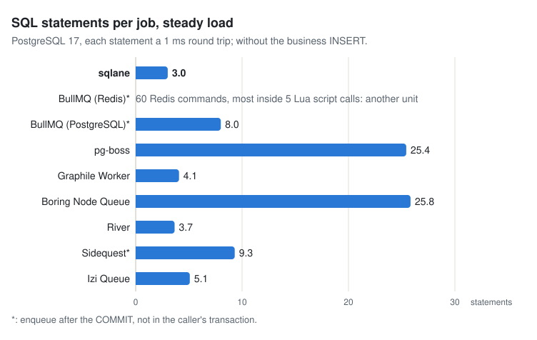
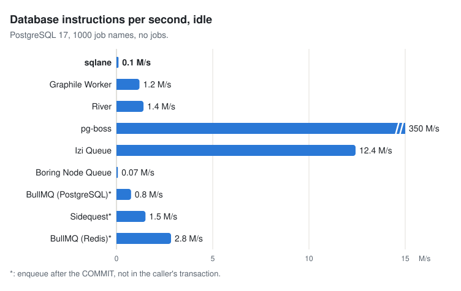

# Performance vs other libraries

What sqlane and seven other job queues for Node.js cost for the same work: CPU and SQL statements per job, the cost
of idle job names, the time from enqueue to start, and the cost of cron schedules. Every library runs on PostgreSQL 17
(BullMQ also on Redis) with empty handlers, so the numbers are the cost of the queue itself, and with 1 ms of network
round trip between each process and its database, as inside one cloud availability zone. For features, see
[features vs other libraries](features_vs_other_libs.md).

\* BullMQ and Sidequest enqueue after the `COMMIT`, not in the caller's transaction.

<!-- generated:conditions -->

- **Measured** on 14 November 2026, on an AMD Ryzen 5 3600 (6 cores, 12 threads), 64 GB, Linux 7.2. The databases and
  the libraries run in one container ([linux.dockerfile](../bench/compare/linux.dockerfile)): Debian 13, Node.js
  26.13.0, PostgreSQL 17.11 and Redis 8.10.3.
- **Versions:** sqlane 5.0.1, Graphile Worker 0.18.0, River for JavaScript 0.3.2, pg-boss 12.38.2, Izi Queue 0.10.0,
  Boring Node Queue 0.9.1, BullMQ 6.7.4, Sidequest 1.17.0.
- **Network:** 0.5 ms each way on the container's loopback (netem), so each round trip between a process and its
  database takes 1 ms.
- **Workers:** one worker process with 8 concurrent jobs; pg-boss has its slots per queue, so up to 8 per job name.
- **Instructions** are user and kernel instructions of every process of a library and of its database. They come from up
  to 8 runs at once (the schedules: 9); times come from one library at a time.
- **One run:** differences of about 10% are noise.
- **BullMQ on Redis** syncs its append-only file every second (`appendfsync everysec`), so a crash can lose up to a
  second of jobs.

<!-- /generated:conditions -->

Settings changed from each library's defaults, as its documentation offers for throughput:

| Library   | Setting                                                                          | Default                     |
| --------- | -------------------------------------------------------------------------------- | --------------------------- |
| River     | `fetchCooldown: 1 ms`                                                            | 100 ms                      |
| pg-boss   | `batchSize: 8`, `burstWhenBatchFull: true`                                       | 1, off                      |
| pg-boss   | `useListenNotify`, `notify` on each queue                                        | off                         |
| pg-boss   | `cronWorkerIntervalSeconds: 1`                                                   | 5 s                         |
| Izi Queue | `pollInterval: 100 ms`                                                           | 1 s                         |
| Izi Queue | CronPlugin `interval: 1 s`                                                       | 60 s                        |
| Sidequest | Schedules registered in one worker only ([cron](features_vs_other_libs.md#cron)) | every worker registers them |

## CPU per job

A producer enqueues 20 jobs per second, each in a transaction with an `INSERT` into a business table, over 1000 job
names. CPU instructions per job, in the worker, the producer and the database:

<!-- generated:cpu -->

<picture>
  <source media="(prefers-color-scheme: dark)" srcset="https://raw.githubusercontent.com/sqlane/sqlane-node/main/docs/images/perf_cpu_per_job_dark.svg">
  
</picture>

On PostgreSQL, the other libraries use 1.8–7.3× as many instructions per job as sqlane (3.4 M). BullMQ on Redis uses
4.1 M (1.2×), after the commit.

<!-- /generated:cpu -->

## Statements per job

The SQL statements per job of the same steady load, without the business `INSERT` and its transaction. Each one is a
round trip to the database. BullMQ on Redis: Redis commands per job.

<!-- generated:statements -->

<picture>
  <source media="(prefers-color-scheme: dark)" srcset="https://raw.githubusercontent.com/sqlane/sqlane-node/main/docs/images/perf_statements_dark.svg">
  
</picture>

sqlane runs 3.0 statements per job, the others 3.7–14.3; BullMQ on Redis sends 60 Redis commands per job.

<!-- /generated:statements -->

## Idle job names

No jobs, 1000 job names handled. CPU instructions per second of the database:

<!-- generated:idle -->

<picture>
  <source media="(prefers-color-scheme: dark)" srcset="https://raw.githubusercontent.com/sqlane/sqlane-node/main/docs/images/perf_idle_dark.svg">
  
</picture>

sqlane's database uses 0.2 M instructions per second; the other libraries' 0.7–261 M (3.5–1,200×). BullMQ on Redis:
2.9 M.

<!-- /generated:idle -->

## Latency

From the enqueue to the start of the handler, at the steady load, one library at a time. For BullMQ and Sidequest,
the enqueue comes after the `COMMIT`.

<!-- generated:latency -->

<picture>
  <source media="(prefers-color-scheme: dark)" srcset="https://raw.githubusercontent.com/sqlane/sqlane-node/main/docs/images/perf_latency_dark.svg">
  
</picture>

sqlane: p50 4 ms, p99 5 ms. The other libraries, except the two that only poll: p50 3–6 ms, p99 4–202 ms. Boring Node
Queue (a poll every 2 s when idle): p50 862 ms, p99 2010 ms; Sidequest (a poll every 100 ms): p50 59 ms, p99 112 ms.
BullMQ on Redis: p50 4 ms, p99 4 ms, after the commit.

<!-- /generated:latency -->

## Schedules

1000 cron schedules due every minute (`* * * * *`), with 3 worker processes. CPU instructions per fired job, in the
workers and the database. In every run, every library added each of the 2000 slots of the window exactly once.

<!-- generated:schedules -->

<picture>
  <source media="(prefers-color-scheme: dark)" srcset="https://raw.githubusercontent.com/sqlane/sqlane-node/main/docs/images/perf_cron_dark.svg">
  
</picture>

With 3 workers, the other libraries use 2.9–13× as many instructions per fired slot as sqlane (1.9 M); BullMQ on Redis
uses 3.3 M (1.8×).

<!-- /generated:schedules -->

## sqlane on each backend

sqlane's hot paths on PostgreSQL, MySQL and MariaDB, under steady load: SQL statements and CPU instructions per
operation ([pnpm bench](../bench/regression/ab.mjs)). CI also checks the statement counts of each supported version
([bench:statements](../bench/regression/snapshot.json)).

<!-- generated:backends -->

| Per operation: statements · instructions                                                  | PostgreSQL 17.11 | MySQL 8.4.13   | MariaDB 11.8.9 |
| ----------------------------------------------------------------------------------------- | ---------------- | -------------- | -------------- |
| `enqueue`, in a transaction of its own                                                    | 1.00 · 0.96 M    | 5.00 · 2.04 M  | 5.00 · 1.57 M  |
| `enqueueMany` of 100 jobs                                                                 | 1.00 · 20.0 M    | 5.00 · 33.9 M  | 5.00 · 28.2 M  |
| A job: its enqueue, claim, run and completion, over 1000 job names                        | 3.01 · 2.93 M    | 18.18 · 9.70 M | 18.28 · 7.94 M |
| A second of a worker with 1000 job names and no job                                       | 0.200 · 0.55 M   | 0.200 · 2.22 M | 0.200 · 0.70 M |
| A job with one of 100 keys of a global limit of 1: its enqueue, claim, run and completion | 11.05 · 7.94 M   | 25.51 · 14.9 M | 25.86 · 17.0 M |
| A schedule firing, one of 1000 `every: '10s'` schedules                                   | 0.053 · 0.67 M   | 0.084 · 0.93 M | 0.084 · 0.89 M |

Statements and CPU instructions of the sqlane processes and the database server, under steady load (`pnpm
bench:regression`), without network delay, 16 November 2026, on an AMD Ryzen 5 3600 (6 cores, 12 threads), 64 GB, Linux
7.2.

<!-- /generated:backends -->

## Method

How each number is measured, the runs, and how to reproduce them: [bench/compare](../bench/compare/README.md).
